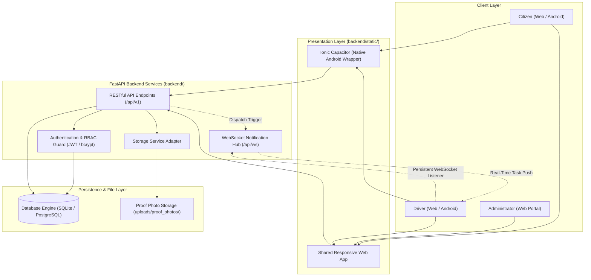

# Smart Waste Collection and Management System (SCOS)

<p align="center">
  <a href="https://scos-app.onrender.com">
    
  </a>
  <a href="https://github.com/PRAHULREDD/SCOS-App/releases/download/v3.0/app-release.apk">
    
  </a>
</p>

---

## Project Overview

Municipal solid waste management in expanding urban environments frequently suffers from fragmented communication, unverified collection pickups, and a lack of real-time operational visibility. Citizens lack transparent mechanisms to report waste accumulation, municipal coordinators struggle to dispatch personnel effectively, and collection drivers lack structured routing and proof-of-work systems.

The **Smart Waste Collection and Management System (SCOS)** resolves these operational bottlenecks through an integrated, cross-platform municipal platform. Built on modern asynchronous backend architecture and a unified responsive client layer, SCOS connects residents, municipal administrators, and sanitation drivers into a single closed-loop workflow: from initial geotagged reporting to real-time administrative dispatch and cryptographic proof-of-collection verification.

---

## Engineering Highlights

- **Role-Based Access Control (RBAC):** Independent authentication, route protection, and navigational context for three distinct municipal roles: `CITIZEN`, `ADMIN`, and `DRIVER`, secured via stateless JSON Web Tokens (JWT) and bcrypt password hashing.
- **Geotagged Complaint Lifecycle:** Citizens report waste incidents with category classification, severity weighting, descriptions, and browser/device GPS coordinates. Reports transition deterministically through `PENDING`, `ASSIGNED`, and `RESOLVED` states.
- **Geospatial Administrative Dispatch:** Administrators monitor open municipal complaints plotted on an interactive Leaflet map using real coordinate telemetry, review operational metrics, and dispatch tasks directly to active drivers.
- **Event-Driven Real-Time Driver Push:** Persistent WebSocket channels (`/api/ws/driver/{id}`) deliver instant task assignment notifications to active driver sessions, eliminating polling latency.
- **Photographic Proof-of-Collection Verification:** Field drivers complete tasks by submitting mandatory photographic collection evidence, programmatically resolving the associated complaint and maintaining an auditable digital record.
- **Civic Gamification & Rewards:** Citizen reporting is incentivized through an EcoRewards ledger where recorded EcoPoints can be redeemed for community catalog items.
- **Cross-Platform Hybrid Architecture:** A single modular frontend powers desktop browsers, mobile viewports, and native Android packages via Ionic Capacitor, maintaining 100% web-to-mobile asset parity.
- **Enterprise Async Data Layer:** SQLAlchemy 2.0 Async ORM with asynchronous SQLite (`aiosqlite`) for local development and asynchronous PostgreSQL (`asyncpg`) support for containerized multi-tier deployments.
- **Automated Quality Assurance:** 116 comprehensive automated tests (covering authentication, role endpoints, database isolation, concurrent redemptions, and WebSocket notifications) alongside a GitHub Actions CI pipeline.

---

## Technology Stack

| Domain | Technology | Version / Specification | Architectural Purpose |
| :--- | :--- | :--- | :--- |
| **Frontend** | HTML5 / CSS3 / ES6+ | Modern Modular JavaScript | Single-source responsive web application |
| | Tailwind CSS | v3.x (CDN-delivered) | Utility-first responsive design system |
| | Leaflet.js | v1.9.4 | Interactive geospatial mapping & complaint coordinate plotting |
| | OpenStreetMap | Standard Tile Layer | Open-access geographic tile provider |
| **Backend** | Python | 3.10+ | Core asynchronous application runtime |
| | FastAPI | v0.109+ | High-concurrency ASGI REST and WebSocket framework |
| | Uvicorn | v0.27+ | Production-grade ASGI web server |
| | Pydantic | v2.x | Request/response schema validation and type enforcement |
| **Database & ORM** | SQLAlchemy | 2.0 (Async) | Asynchronous Declarative ORM and session management |
| | aiosqlite | v0.19+ | Async driver for local SQLite engine |
| | asyncpg | v0.29+ | High-performance async driver for PostgreSQL |
| | Alembic | v1.13+ | Database schema versioning and migration management |
| **Security & Auth** | python-jose | v3.3+ | Cryptographic JWT signing and Bearer token verification |
| | passlib / bcrypt | Rounds = 12 | Salted password hashing and authentication security |
| | RBAC | Route Dependencies | Strict role enforcement across protected endpoints |
| **Android Runtime** | Ionic Capacitor | v6.x | Native Android bridge embedding shared web assets |
| | Android SDK | Target SDK 34 / 36 | Android native platform target (Min SDK 24) |
| | Gradle Wrapper | 8.14.3 | Android build system with v2 APK signature verification |
| | OpenJDK | 21 LTS (Adoptium) | Java development kit for Android compilation |
| **Infrastructure** | Docker & Compose | Compose Spec v2 | Multi-container service definitions (dev & prod) |
| | Nginx | Alpine Linux | Production reverse proxy and static asset delivery |
| | Render | Cloud Platform | Ephemeral containerized cloud deployment |
| **Testing & CI** | Pytest | pytest-asyncio | 116-test automated backend test suite |
| | HTTPX | v0.26+ | Asynchronous HTTP test client |
| | Flake8 | Syntax Linters | Static code hygiene and PEP8 error validation |
| | GitHub Actions | Ubuntu Runners | Continuous Integration pipeline on push / pull request |

---

## System Architecture



---

## Core Workflow

```text
1. Citizen Reports Waste
   │  • Selects waste category & severity level (Low, Medium, High, Hazardous)
   │  • Inputs description and attaches GPS coordinates
   ▼
2. Complaint Registered (Status: PENDING)
   │  • Database record created; coordinates plotted on Admin Leaflet map
   ▼
3. Administrator Reviews & Dispatches Task
   │  • Admin evaluates open complaints and assigns an active municipal driver
   │  • Complaint transitions to ASSIGNED; DriverTask record generated
   ▼
4. Real-Time Driver Notification
   │  • WebSocket push delivers instant task alert to driver session
   │  • Task appears in driver field queue with location & waste details
   ▼
5. Waste Collection Executed & Verified
   │  • Driver collects municipal waste at designated location
   │  • Driver submits photographic proof through in-app camera upload
   ▼
6. Complaint Resolution (Status: RESOLVED)
   │  • Proof stored; task marked completed; complaint updated to RESOLVED
   │  • Closed-loop audit trail recorded
```

---

## Application Screenshots

### Citizen Reporting & Rewards

| Citizen Dashboard | Report Waste Complaint |
| :---: | :---: |
|  |  |
| *Citizen overview with report counts & EcoPoints balance* | *Geotagged waste reporting form with severity selection* |

| Complaint History | EcoRewards Catalog |
| :---: | :---: |
|  |  |
| *Status tracking from PENDING to RESOLVED* | *Community rewards redeemable via earned EcoPoints* |

### Administrator Dispatch & Driver Logistics

| Admin Interactive Map & Density View | Driver Task Execution Queue |
| :---: | :---: |
|  |  |
| *Real-time complaint marker distribution across municipal zones* | *Assigned pickup queue with real-time status toggles* |

| Digital Pickup Verification | Authentication & Access Gate |
| :---: | :---: |
|  |  |
| *Driver proof-of-collection camera upload interface* | *Role-aware secure JWT authentication portal* |

---

## Security & Engineering Architecture

- **Stateless Token Authentication:** User authentication issues signed HMAC-SHA256 JWT tokens containing `sub` (user ID), `role`, and expiration claims. Tokens are verified on every protected API call via FastAPI dependency injection.
- **Cryptographic Password Security:** User passwords are never stored in plaintext; passwords are salted and hashed using `bcrypt` (12 rounds) via `passlib.context.CryptContext`.
- **Role-Based Authorization:** Access to endpoints is gated through a modular dependency hierarchy (`get_current_user` -> `require_role(["ADMIN", ...])`), preventing privilege escalation across Citizen, Admin, and Driver portals.
- **Asynchronous Concurrency:** The backend runs fully non-blocking I/O using FastAPI and SQLAlchemy 2.0 Async Sessionmaker (`AsyncSession`), maintaining high throughput under concurrent requests.
- **Data Validation & Sanitization:** All inbound REST payloads and outbound responses are validated against Pydantic v2 schemas (`UserCreate`, `ComplaintCreate`, `DriverTaskUpdate`, etc.), rejecting malformed requests at the network perimeter.
- **Secure Android Signing Architecture:** The Gradle build configuration retrieves release keystore paths and credentials strictly from environment variables (`SCOS_KEYSTORE_PATH`, `SCOS_KEYSTORE_PASSWORD`, etc.), preventing keystores or signing secrets from ever entering Git tracking.
- **Modular Service Layer:** Strict separation of concerns is maintained throughout: REST route controllers (`api/v1/`) delegate business rules to service modules (`services/`), which interact with asynchronous database abstractions (`repositories/`).

---

## Deployment & Operational Scope

### Production Deployments

- **Live Web Application:** [https://scos-app.onrender.com/](https://scos-app.onrender.com/) *(automatically redirects root traffic to the responsive web app at `/app/index.html`)*
- **Interactive OpenAPI Documentation:** [https://scos-app.onrender.com/docs](https://scos-app.onrender.com/docs)
- **Alternative Redoc Documentation:** [https://scos-app.onrender.com/redoc](https://scos-app.onrender.com/redoc)
- **Health Check Probe:** [https://scos-app.onrender.com/health](https://scos-app.onrender.com/health)
- **Native Android APK:** Available directly from [GitHub Releases v3.0](https://github.com/PRAHULREDD/SCOS-App/releases/tag/v3.0) as [`app-release.apk`](https://github.com/PRAHULREDD/SCOS-App/releases/download/v3.0/app-release.apk).

### Architectural Boundaries & Limitations

- **Render Free Ephemeral Filesystem:** Render Free instances utilize an ephemeral disk. When the free container spins down after inactivity, local SQLite databases and uploaded proof photos are reset. To support five-minute demonstrations, the backend includes environment-variable bootstrap (`SCOS_DEMO_ADMIN_EMAIL`, etc.) that automatically provisions designated Admin and Driver accounts on startup.
- **Database Persistence Options:** PostgreSQL persistence via `DATABASE_URL` is supported in code via `asyncpg` and containerized multi-service Docker definitions, though marked experimental in local environments without an active PostgreSQL daemon.
- **Scope Discipline:** SCOS is strictly focused on human-reported municipal waste workflows. It does not incorporate physical IoT smart-bin telemetry, machine learning waste categorization, or automated vehicular route optimization.

---

## Repository Structure

```text
SCOS/
├── .github/
│   └── workflows/
│       └── ci.yml                  # GitHub Actions CI pipeline (lint, test, docker)
├── backend/
│   ├── alembic/                    # Database schema migrations
│   ├── app/
│   │   ├── api/v1/                 # Role-gated REST endpoints (auth, citizens, drivers, admin)
│   │   ├── core/                   # Security, JWT utilities, and configuration
│   │   ├── db/                     # Async engine & sessionmaker definitions
│   │   ├── models/                 # SQLAlchemy 2.0 declarative database models
│   │   ├── repositories/           # Asynchronous data access layer
│   │   ├── schemas/                # Pydantic request/response validation schemas
│   │   ├── services/               # Core business logic services
│   │   └── websocket/              # Real-time WebSocket connection manager
│   ├── static/                     # Shared responsive frontend web application
│   │   ├── app/                    # Citizen, Admin, Driver, and Auth screen modules
│   │   └── js/                     # Shared frontend API client & state management
│   ├── tests/                      # Automated test suite (116 unit & integration tests)
│   ├── uploads/                    # Local storage directory for collection proof photos
│   ├── Dockerfile                  # Container build definition for backend service
│   ├── main.py                     # FastAPI application lifespan, routing, and WebSockets
│   ├── requirements.txt            # Python dependencies
│   └── seed_db.py                  # Optional local development data seeder
├── docs/                           # Architectural assets, performance benchmarks & documentation
│   └── assets/                     # Performance charts and reference figures
├── infra/                          # Infrastructure configurations (Nginx, database schemas, monitoring)
├── mobile/
│   ├── android/                    # Native Android Studio / Gradle project
│   │   └── app/build.gradle        # Android application build & release signing configuration
│   ├── capacitor.config.json       # Ionic Capacitor bridge configuration
│   └── package.json                # Mobile build dependencies
├── scripts/                        # Development automation & asset synchronization scripts
├── docker-compose.yml              # Local containerized multi-service stack
├── docker-compose.prod.yml         # Production multi-service stack definition
├── CONTRIBUTING.md                 # Contribution guidelines, git workflow, and testing instructions
├── LICENSE                         # MIT License
└── README.md                       # Comprehensive engineering presentation
```

---

## Local Setup & Development

### Prerequisites

- **Python:** Version 3.10 or later
- **Git:** Version 2.30 or later
- **Node.js & npm:** Version 18+ *(required only for Android asset packaging)*
- **Java / JDK:** OpenJDK 21 LTS *(required only for Android compilation)*

---

### Backend Setup

#### 1. Clone the repository

```bash
git clone https://github.com/PRAHULREDD/SCOS-App.git
cd SCOS-App
```

#### 2. Create and activate a virtual environment

**On Windows (PowerShell):**
```powershell
python -m venv backend/venv
.\backend\venv\Scripts\Activate.ps1
```

**On Linux / macOS:**
```bash
python3 -m venv backend/venv
source backend/venv/bin/activate
```

#### 3. Install dependencies

```bash
python -m pip install --upgrade pip
pip install -r backend/requirements.txt
```

#### 4. Run the automated test suite

```bash
python -m pytest backend/tests -o pythonpath=backend -q
```

*Expected output: `116 passed in ~2m`.*

#### 5. Launch the local development server

```bash
uvicorn main:app --app-dir backend --host 127.0.0.1 --port 8000 --reload
```

Access the application in your browser:
- **Web Portal:** [http://127.0.0.1:8000/app/index.html](http://127.0.0.1:8000/app/index.html) *(or [http://127.0.0.1:8000/](http://127.0.0.1:8000/))*
- **API Documentation:** [http://127.0.0.1:8000/docs](http://127.0.0.1:8000/docs)

---

### Android Application Build

#### Verify Web-to-Mobile Asset Synchronization

```bash
python scripts/verify_mobile_sync.py
```

#### Build Debug APK

```powershell
# Set JAVA_HOME to JDK 21 if not configured globally
$env:JAVA_HOME = "C:\Users\<username>\AppData\Local\Programs\Eclipse Adoptium\jdk-21.0.12.101-hotspot"

cd mobile/android
.\gradlew.bat assembleDebug
```

*(On Linux / macOS: `./gradlew assembleDebug`)*

The output APK will be generated at:
```text
mobile/android/app/build/outputs/apk/debug/app-debug.apk
```

#### Build Signed Release APK

```powershell
$env:SCOS_KEYSTORE_PATH = "C:\path\to\scos-release.jks"
$env:SCOS_KEYSTORE_PASSWORD = "<keystore-password>"
$env:SCOS_KEY_ALIAS = "scos-release"
$env:SCOS_KEY_PASSWORD = "<key-password>"

cd mobile/android
.\gradlew.bat assembleRelease
```

The signed release APK will be generated at:
```text
mobile/android/app/build/outputs/apk/release/app-release.apk
```

---

## Contributing

Contributions are welcome. Please review [CONTRIBUTING.md](CONTRIBUTING.md) for branch naming standards, testing conventions, and pull request procedures.

---

## License

This project is licensed under the [MIT License](LICENSE).
