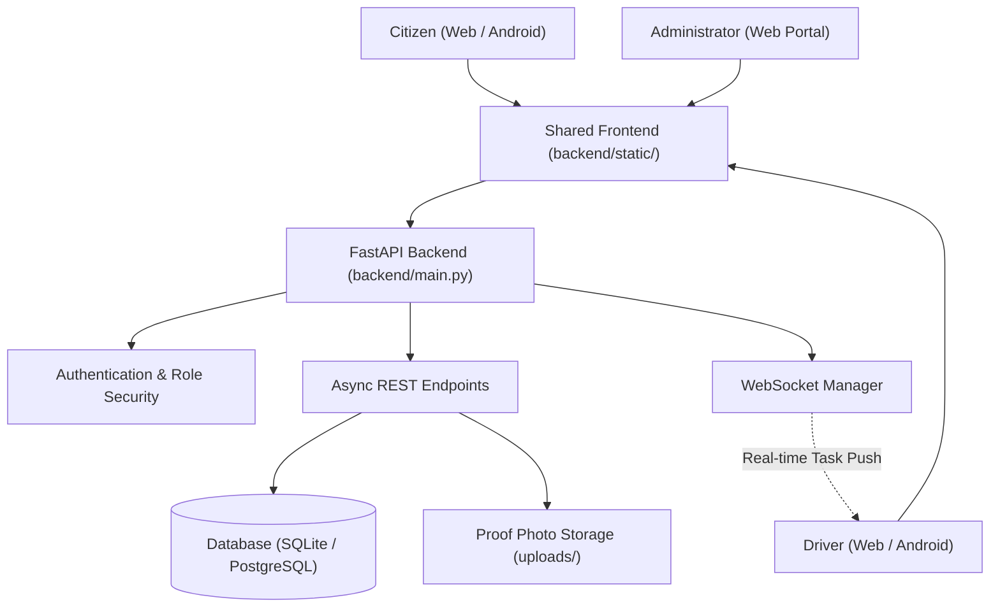

# Smart Waste Collection and Management System (SCOS)

A full-stack municipal waste management platform connecting citizens, administrators, and collection drivers through a shared web and Android application.

<p align="center">
  <a href="https://scos-app.onrender.com/">
    
  </a>
  <a href="https://github.com/PRAHULREDD/SCOS-App/releases">
    
  </a>
  <a href="https://github.com/PRAHULREDD/SCOS-App">
    
  </a>
</p>

<p align="center">
  
  
  
  
</p>

> **Android availability:** The Android application has a locally verified debug APK build, and secure release signing is configured. APK downloads are not currently published; release packages will be available on the [Releases](https://github.com/PRAHULREDD/SCOS-App/releases) page only after a release has actually been published.

---

## Overview

Municipal waste collection requires effective coordination between residents reporting waste, administrators dispatching collection resources, and drivers completing pickups. SCOS provides a centralized, cross-platform system to manage this end-to-end workflow.

The platform allows citizens to submit geotagged waste complaints, administrators to review complaints on an interactive map and assign drivers, and drivers to receive real-time task notifications and submit photographic proof of completed collections.

SCOS employs a hybrid architecture: a shared responsive web application powers both desktop and mobile browsers, while also running as a native Android application via Ionic Capacitor.

---

## Features by Role

### Citizen
- **Account Management:** User registration and secure authentication with JWT.
- **Complaint Reporting:** Submit waste complaints with description, category, severity, and geographic coordinates.
- **Status Tracking:** Monitor complaint lifecycle from `PENDING` to `ASSIGNED` and `RESOLVED`.
- **EcoRewards System:** View EcoPoints balance and redeem points for community reward items (automated point earning on complaint verification is not implemented).
- **Community Leaderboard:** View top contributors and municipal environmental rankings based on recorded EcoPoints.

### Administrator
- **Complaint Management:** Review and prioritize citizen waste reports with reported zone and area labels.
- **Interactive Map Visualization:** View reported complaints as circle markers on an interactive Leaflet map using GPS coordinates.
- **Driver Assignment:** Dispatch collection tasks directly to registered municipal drivers.
- **Operational Oversight:** View complaint resolution rates and collection statistics calculated from database records.

### Driver
- **Task Queue:** View assigned collection tasks with waste type, urgency, and pickup location.
- **Real-Time Notifications:** Receive instant task dispatch notifications over persistent WebSockets.
- **Proof of Collection:** Capture and submit photographic proof upon waste collection.
- **Status Updates:** Mark collection tasks completed, triggering complaint resolution.

---

## Application Workflow

```text
Citizen Reports Waste
         |
         v
Complaint Created (Status: PENDING)
         |
         v
Administrator Reviews Complaint
         |
         v
Driver Assigned (WebSocket Notification Sent)
         |
         v
Driver Receives Task (Status: ASSIGNED)
         |
         v
Waste Collection Completed
         |
         v
Photo Proof Submitted by Driver
         |
         v
Complaint Marked Resolved (Status: RESOLVED)
```

---

## Technology Stack

| Component | Technologies | Details |
|---|---|---|
| **Backend Framework** | Python 3.10+, FastAPI, Uvicorn | High-concurrency async REST and WebSocket APIs |
| **Frontend Application** | HTML5, CSS3, JavaScript (ES6+), Tailwind CSS | Shared responsive web app (Tailwind loaded via CDN) |
| **Database** | SQLite (Default), PostgreSQL (Experimental) | SQLite for local development; PostgreSQL support via asyncpg is experimental / unverified locally |
| **ORM & Database Layer** | SQLAlchemy 2.0 (Async), aiosqlite, asyncpg | Fully asynchronous session handling and query execution |
| **Authentication & Security** | JWT (python-jose), OAuth2, bcrypt | Password hashing (rounds=12) and Bearer token access |
| **Real-Time Communication** | FastAPI WebSockets | Event-driven notifications to active driver sessions |
| **Interactive Maps** | Leaflet.js, OpenStreetMap | Geolocation mapping and complaint location marker display |
| **Mobile Runtime** | Ionic Capacitor (Android) | Native Android wrapper embedding shared frontend |
| **Containerization** | Docker, Docker Compose, Nginx | Multi-service orchestration and reverse proxy configuration |
| **Testing** | Pytest, pytest-asyncio, httpx | Automated backend API and integration test suite |
| **CI** | GitHub Actions | Automated linting, test execution, and Docker validation (deployment job is a placeholder) |

---

## System Architecture



---

## Repository Structure

```text
SCOS/
├── .github/
│   └── workflows/
│       └── ci.yml              # GitHub Actions CI pipeline
├── backend/
│   ├── app/
│   │   ├── api/v1/             # REST route endpoints (auth, citizens, drivers, admin)
│   │   ├── core/               # Security, authentication, and configuration
│   │   ├── db/                 # Database engine and async session factories
│   │   ├── models/             # SQLAlchemy declarative models
│   │   ├── repositories/       # Asynchronous data access layer
│   │   ├── schemas/            # Pydantic request and response schemas
│   │   ├── services/           # Business logic services
│   │   └── websocket/          # WebSocket connection manager
│   ├── static/                 # Shared responsive frontend web application
│   ├── tests/                  # Pytest test suite (116 automated tests)
│   ├── uploads/                # Proof photos and uploaded media
│   ├── Dockerfile              # Backend container build definition
│   ├── main.py                 # FastAPI entry point, lifespan, and WebSocket endpoint
│   ├── requirements.txt        # Python package dependencies
│   └── seed_db.py              # Optional development database seeder
├── docs/                       # Project architectural assets and documentation
├── infra/                      # Infrastructure configurations (database, monitoring, nginx)
├── mobile/
│   ├── android/                # Native Android Studio / Gradle project
│   ├── capacitor.config.json   # Capacitor bridge configuration
│   └── package.json            # Capacitor CLI and core dependencies
├── scripts/                    # Verification and automation scripts
├── docker-compose.yml          # Local containerized multi-service development stack
├── docker-compose.prod.yml     # Production containerized multi-service stack
├── CONTRIBUTING.md             # Guidelines for project contributions
├── LICENSE                     # MIT License
└── README.md                   # Project documentation
```

---

## Getting Started

### Prerequisites

- **Python:** Version 3.10 or later
- **Git:** Version 2.30 or later
- **Node.js & npm:** Version 18+ (required only for Android mobile build)
- **Java & Android SDK:** JDK 21 and Android SDK (required only for Android builds)

---

### Local Backend Setup

#### 1. Clone the repository

```powershell
git clone https://github.com/PRAHULREDD/SCOS-App.git
cd SCOS-App
```

#### 2. Create and activate a virtual environment

```powershell
python -m venv backend/venv
.\backend\venv\Scripts\Activate.ps1
```

*(On Linux / macOS: `source backend/venv/bin/activate`)*

#### 3. Install dependencies

```powershell
python -m pip install --upgrade pip
pip install -r backend/requirements.txt
```

#### 4. Database Setup

- **Automatic Schema Creation (Default):**
  When using SQLite (the default development database), the application automatically creates missing tables on startup during the FastAPI lifespan via SQLAlchemy (`Base.metadata.create_all`).

  *Note: `Base.metadata.create_all` only creates tables that do not yet exist; it does not alter columns or migrate existing database schemas when models change. It is not an automated database migration system.*

- **Optional Demo Data Seeder (`seed_db.py`):**
  If you wish to populate the local database with sample users, complaints, and reward items for testing, run the optional seeder:

```powershell
python backend/seed_db.py
```

  > [!WARNING]
  > `seed_db.py` is strictly an optional development script. It seeds hardcoded test accounts (with password `password`) and will reset existing seeded accounts' passwords and EcoPoints. **Never run this script against Render or any production database.**

- **Cloud Demo Account Bootstrap (Render):**
  When deploying to cloud environments with ephemeral filesystems (like Render Free), the application automatically provisions one `ADMIN` and one `DRIVER` account during startup if the following environment variables are set:
  - `SCOS_DEMO_ADMIN_EMAIL`
  - `SCOS_DEMO_ADMIN_PASSWORD`
  - `SCOS_DEMO_DRIVER_EMAIL`
  - `SCOS_DEMO_DRIVER_PASSWORD`

  > [!NOTE]
  > This bootstrap only creates the designated admin and driver accounts if they do not already exist. It does not provide database persistence and does not restore citizen accounts, complaints, rewards, incidents, or other database records after a filesystem reset. PostgreSQL via `DATABASE_URL` is an experimental database persistence option (subject to supported configuration), while external object storage is an external requirement for persistent uploaded proof photos.

#### 5. Start the application

Because the application package structure relies on `app.*` imports, set the application directory to `backend`:

**From repository root:**
```powershell
uvicorn main:app --app-dir backend --host 127.0.0.1 --port 8000 --reload
```

**Alternatively, from the `backend/` directory:**
```powershell
cd backend
uvicorn main:app --host 127.0.0.1 --port 8000 --reload
```

Once running, access:
- **Web Application:** [http://127.0.0.1:8000/](http://127.0.0.1:8000/) *(redirects to `/app/index.html`)*
- **Direct Web Application URL:** [http://127.0.0.1:8000/app/index.html](http://127.0.0.1:8000/app/index.html)
- **Interactive API Documentation:** [http://127.0.0.1:8000/docs](http://127.0.0.1:8000/docs)
- **Alternative API Documentation:** [http://127.0.0.1:8000/redoc](http://127.0.0.1:8000/redoc)
- **Health Check Endpoint:** [http://127.0.0.1:8000/health](http://127.0.0.1:8000/health)

---

## Android Application

SCOS uses Ionic Capacitor to package the shared frontend (`backend/static/`) into a native Android application.

### Synchronize frontend assets

Before building the Android app or after editing frontend code, verify that assets are synchronized:

```powershell
python scripts/verify_mobile_sync.py
```

To update Capacitor dependencies and copy web assets into the Android native project:

```powershell
cd mobile
npm install
npx cap sync android
```

### Build Android Debug APK

To compile the debug APK using the Gradle wrapper, ensure `JAVA_HOME` is set to your JDK 21 installation:

```powershell
# Set JAVA_HOME for the current session if not set globally
$env:JAVA_HOME = "C:\Users\<username>\AppData\Local\Programs\Eclipse Adoptium\jdk-21.0.12.101-hotspot"

cd mobile/android
.\gradlew.bat assembleDebug
```

*(On Linux / macOS: `./gradlew assembleDebug`)*

The compiled APK will be generated at:
```text
mobile/android/app/build/outputs/apk/debug/app-debug.apk
```

### Build Android Signed Release APK

Release signing is configured via environment variables (preventing credentials from ever being stored in repository files):

```powershell
$env:SCOS_KEYSTORE_PATH = "path\to\release.jks"
$env:SCOS_KEYSTORE_PASSWORD = "<keystore-password>"
$env:SCOS_KEY_ALIAS = "your-key-alias"
$env:SCOS_KEY_PASSWORD = "<key-password>"

cd mobile/android
.\gradlew.bat assembleRelease
```

> [!NOTE]
> The values above are placeholders. `SCOS_KEYSTORE_PATH`, `SCOS_KEY_ALIAS`, and passwords must match the actual file path, key alias, and credentials of your specific signing keystore. Never commit real signing credentials or keystores to Git.

The signed release APK will be generated at:
```text
mobile/android/app/build/outputs/apk/release/app-release.apk
```

*Note: The Gradle release configuration enforces that all four environment variables are present and the keystore file exists, failing fast with an informative error if any are missing.*

---

## Testing & Quality Verification

### Run backend tests

Execute the complete backend test suite from the repository root:

```powershell
python -m pytest backend/tests -o pythonpath=backend -q
```

Or from the `backend/` directory:

```powershell
cd backend
python -m pytest
```

### Verify mobile asset parity

```powershell
python scripts/verify_mobile_sync.py
```

### Validate Docker configurations

Validate Docker Compose syntax and configuration without starting containers:

```bash
docker compose config
docker compose -f docker-compose.prod.yml config
```

*(On systems with standalone Docker Compose v1, use `docker-compose config`)*

### Continuous Integration (CI)

The project includes an automated GitHub Actions workflow (`.github/workflows/ci.yml`) that triggers on pushes and pull requests to `main`:
- **Lint Code:** Flake8 syntax and error checks (`E9,F63,F7,F82`).
- **Backend Tests:** Automated pytest execution in an isolated environment.
- **Docker Validation:** Docker Compose configuration check and backend Docker container build.
*(Note: The deployment job is a placeholder workflow step and does not automatically push live deployments to production).*

---

## Deployment Information

### Render Cloud Deployment
- **Live URL:** [https://scos-app.onrender.com/](https://scos-app.onrender.com/)
- The service builds and runs from `backend/Dockerfile` with container working directory `/app`.
- **Ephemeral Storage Notice:** Render Free instances run on an ephemeral filesystem. If using SQLite on local disk, all stored database records and uploaded proof photos are wiped whenever the instance spins down, restarts, or redeploys.
- **Demo Account Bootstrap:** Setting `SCOS_DEMO_ADMIN_EMAIL`, `SCOS_DEMO_ADMIN_PASSWORD`, `SCOS_DEMO_DRIVER_EMAIL`, and `SCOS_DEMO_DRIVER_PASSWORD` allows automatic creation of one `ADMIN` and one `DRIVER` account on startup after a reset. **This bootstrap does not provide database persistence**: it does not restore citizen accounts, complaints, rewards, incidents, or uploaded files.
- **Production Persistence:** PostgreSQL via the `DATABASE_URL` environment variable is an experimental database persistence option (unverified in local testing without an active PostgreSQL instance). External object storage is a requirement for persistent uploaded proof photos, not a feature claimed as already integrated into the cloud service.

### Docker Compose Deployment
To run the full stack locally with containerized services:
```bash
docker compose up -d
# Or: docker-compose up -d
```
To validate and launch the production stack:
```bash
docker compose -f docker-compose.prod.yml up -d
# Or: docker-compose -f docker-compose.prod.yml up -d
```

---

## Project Scope & Boundaries

SCOS is designed with clear architectural and functional scope boundaries:

- **Three Roles Only:** Exactly `CITIZEN`, `ADMIN`, and `DRIVER` roles are implemented.
- **No AI/ML Claims:** The project does not use machine learning models for waste categorization, severity prediction, or automated vehicle routing.
- **No IoT Sensors:** The system does not integrate with physical smart-bin sensors or fill-level hardware; complaint reports are submitted by human users.
- **WebSocket Driver Notifications:** Driver notifications are delivered in real time over active WebSocket connections (`/api/ws/driver/{id}`). Native OS push notification services (e.g. FCM/APNs) are not utilized.
- **Real Locations:** Complaint locations are derived from user-submitted geographic coordinates (via browser geolocation or map selection), not simulated sensor telemetry.
- **Role-Based Security:** Role-based access control is enforced on protected citizen, driver, and administrator endpoints and driver WebSocket channels; public endpoints include registration, login, and health check.

---

## Contributing

Contributions are welcome! Please review [CONTRIBUTING.md](CONTRIBUTING.md) for guidelines on code standards, local setup, test execution, and pull request procedures.

---

## License

This project is licensed under the [MIT License](LICENSE).

---

**Smart Waste Collection and Management System (SCOS) — 2026**
[GitHub Repository](https://github.com/PRAHULREDD/SCOS-App) · [Live Application](https://scos-app.onrender.com/) · [Releases](https://github.com/PRAHULREDD/SCOS-App/releases) · [Contributing](CONTRIBUTING.md)
