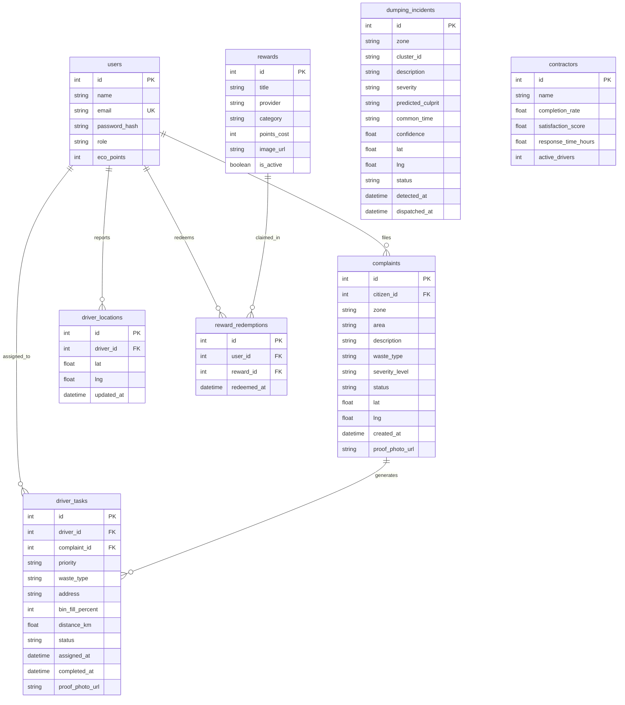

# SCOS Project Memory & Technical Reference

**Document Version:** 1.3.2
**Last Verified Date:** 2026-11-16
**Repository Baseline:** Commit `04251f38ec4f2dc654d25a116ffd3aa4012e9b8d` (short: `04251f3`) on branch `main` represents the repository baseline reference, while implementation descriptions in this document reflect the uncommitted working-tree state as inspected on 2026-11-16 (distinguishing pre-existing modifications, untracked implementation files, and this documentation). These changes are not committed to Git.
**Document Purpose:** Permanent, evidence-based system memory for SCOS (Smart Waste Collection and Management System). Primary technical context for development, auditing, and maintenance by human engineers and AI coding assistants (Antigravity, Claude, ChatGPT, etc.).

---

## 1. Project Identity and Purpose

### 1.1 System Name and Scope
- **Full Name:** Smart Waste Collection and Management System (SCOS)
- **Primary Domain:** Municipal solid-waste reporting, administrative task triage, driver dispatch, collection verification, and citizen community rewards.
- **Client Platforms:** Hybrid Web Application (desktop & mobile browsers) and native Android mobile application compiled via Ionic Capacitor.
- **Backend Architecture:** Asynchronous Python REST API & WebSocket server powered by FastAPI and SQLAlchemy.

### 1.2 Three Operational Roles
SCOS strictly defines and enforces exactly three operational roles:
1. **`CITIZEN`**: Municipal residents who report waste piles, track complaint statuses, accumulate EcoPoints, redeem catalog rewards, and view the authentic community leaderboard.
2. **`ADMIN`**: Municipal dispatchers and waste management supervisors who monitor operational KPIs, review complaint locations on a live map, triage high-priority escalations, register driver accounts, and assign tasks to drivers.
3. **`DRIVER`**: Municipal waste collection vehicle operators who receive real-time dispatch assignments, broadcast live GPS locations, navigate to pickup sites, execute collections, update task statuses, and optionally upload photographic collection proofs.

### 1.3 Core Operational Loop
```mermaid
sequenceDiagram
    autonumber
    actor Citizen as Citizen (Web/Android)
    actor Admin as Admin (Web Command Center)
    actor Driver as Driver (Android App)
    participant API as FastAPI Backend & DB
    participant WS as WebSocket Manager

    Citizen->>API: 1. POST /api/citizen/report_issue (GPS, Waste Type, Description)
    API-->>Citizen: 2. Complaint Created (Status: PENDING) + 10 EcoPoints Awarded
    Admin->>API: 3. GET /api/admin/complaints & /api/admin/waste_heatmap
    API-->>Admin: 4. Returns Live Complaints, Coordinates & proof_photo_url
    Admin->>API: 5. POST /api/admin/assign_task (complaint_id, driver_id)
    API->>API: 6. Atomic Transaction: Complaint IN_PROGRESS, DriverTask ASSIGNED (Committed to DB)
    API->>WS: 7. Post-Commit Attempt: notify_driver_new_task(driver_id, complaint_id)
    WS-->>Driver: 8. WebSocket Event: NEW_TASK (If Connected; Observed in Android Emulator; Not Guaranteed)
    Driver->>API: 9. POST /api/driver/update_location (Live GPS)
    Driver->>API: 10. POST /api/driver/complete_pickup (complaint_id, optional proof_photo multipart)
    API->>API: 11. Atomic CAS Claim, Validates Photo (if provided), Saves via Storage Abstraction (Deterministic Key), Sets Complaint RESOLVED & Task COMPLETED
    API-->>Driver: 12. Verification Success
    Admin->>API: 13. GET /api/driver/proof_photo/{task_id} (Admin Waste Heatmap/List & Citizen History UI Viewers Completed in Phase 3)
    Citizen->>API: 14. GET /api/citizen/my_reports (Status: RESOLVED & proof_photo_url)
```

> [!NOTE]
> **Proof-Photo Inspection & Storage Architecture Status:** The proof-photo pipeline is fully operational across backend and frontend. Pickup completion succeeds with or without a proof photo (`proof_photo` is optional); when provided, the photo is validated unconditionally against extension, MIME type, magic bytes, and size ($\le$ 5 MiB, rejecting zero-byte files) before being persisted via `BaseStorageService` with a deterministic key (`proofs/tasks/task_{task_id}{verified_ext}`). When completed without a photo, `proof_photo_url` remains null. The backend endpoints `GET /api/driver/proof/{task_id}` and `GET /api/driver/proof_photo/{task_id}` serve authorized images with role-based ownership checks (`ADMIN`, assigned `DRIVER`, reporting `CITIZEN`). Proof photos are handled through the storage abstraction (`BaseStorageService`), with `STORAGE_BACKEND` selecting the configured provider (`local` default for development; `s3` adapter implemented for S3/R2-compatible storage; Cloudflare R2 is **not provisioned or connected**, and production persistence remains unverified). Deterministic keys (`proofs/tasks/task_{task_id}{verified_ext}`) are stored, while database records retain authenticated application API routes (`/api/driver/proof/{task_id}`). Legacy local files remain retrievable through a documented compatibility fallback. Both the Citizen interface (`Complaint History`) and the Admin interface (`Waste Heatmap / Operations` list and Leaflet map popups) include dedicated collection proof photo viewers with authenticated Blob retrieval, client-side MIME validation (`image/jpeg`, `image/png`, `image/webp`), `AbortController` cancellation, request generation tracking to prevent stale responses, and Blob URL lifecycle cleanup.
>
> **Task Assignment & WebSocket Notification Semantics:** Admin task assignment atomically updates the complaint status to `IN_PROGRESS` and creates the `DriverTask` as `ASSIGNED` in the database. The database transaction is committed before WebSocket notification delivery is attempted. Successful notification delivery was observed during documented Android emulator testing. While the backend connection manager delivers notifications in memory without a durable broker, client-side automatic reconnection with exponential backoff, jitter, and state reconciliation upon reconnect (`loadAssignedTasks()`) is implemented in `driver.js` (Phase 5).

### 1.4 Explicit Scope Boundaries: No AI/ML and No IoT
- **NOT an AI/ML Project:** SCOS does not use machine learning, neural networks, or computer vision for waste classification, fraud detection, or volume forecasting. All previously experimental or decorative AI microservices (`ai/` service on port 8001), synthetic pattern prediction hypotheses, and AI confidence badges have been permanently removed. Municipal waste triage is performed manually by human municipal administrators.
- **NOT an IoT Project:** SCOS does not interface with physical smart-bin sensors, ultrasonic fill-level transducers, or automated bin telemetry. All synthetic `bin_fill_percent` telemetry displays and mock hardware sensor indicators have been removed from runtime behavior.
- **Preserved Real Capabilities:** Real device GPS geolocation capture (`navigator.geolocation`), real coordinate validation, live Leaflet mapping, and post-commit WebSocket event dispatch are fully retained and operational.

---

## 2. Current Repository Architecture

### 2.1 File Tree & Directory Roles

```text
SCOS/
├── .github/                    # GitHub repository configurations
│   ├── ISSUE_TEMPLATE/         # GitHub issue templates (bug report, feature request)
│   ├── PULL_REQUEST_TEMPLATE.md# Standard pull request description template
│   └── workflows/
│       └── ci.yml              # GitHub Actions CI/CD workflows (linting, test execution)
├── audit-results/              # Historical security audits, benchmark traces & scan logs (74 files)
│   ├── bandit-report.json      # Python static AST security audit report
│   ├── semgrep-report.json     # Semgrep vulnerability scan report
│   ├── pip-audit-local.json    # Dependency vulnerability scan report
│   ├── gitleaks-history.json   # Secret leakage git history scan report
│   └── *.txt, *.log            # Benchmark logs, DB review notes, runtime diagnostics
├── backend/                    # Core Python FastAPI Application
│   ├── alembic/                # Database migration environment
│   │   ├── versions/           # Versioned migration revision scripts (4 migrations)
│   │   │   ├── bfa2415d5970_initial_migration.py
│   │   │   ├── c1a2b3c4d5e6_add_description_to_complaints.py
│   │   │   ├── d2e3f4a5b6c7_alter_rewards_is_active_to_boolean.py
│   │   │   └── e4f5a6b7c8d9_add_proof_photo_to_tasks_and_complaints.py
│   │   ├── env.py              # Async Alembic runner configuration
│   │   └── script.py.mako      # Migration script template
│   ├── app/                    # Application source code
│   │   ├── api/                # API route definitions and dependencies
│   │   │   ├── dependencies.py # Authentication & RBAC FastAPI dependencies
│   │   │   └── v1/             # Version 1 REST API routers
│   │   │       ├── admin.py    # Admin operations, complaints, dispatch, heatmap
│   │   │       ├── auth.py     # User registration, OAuth2 login, JWT generation
│   │   │       ├── citizens.py # Citizen reporting, history, rewards, leaderboard
│   │   │       └── drivers.py  # Driver tasks, GPS updates, proof uploads & retrieval
│   │   ├── core/               # Security, password hashing (bcrypt), JWT utilities
│   │   │   └── auth.py
│   │   ├── db/                 # Database connection and async session management
│   │   │   └── database.py
│   │   ├── models/             # SQLAlchemy ORM domain entities (8 domain models)
│   │   │   └── domain.py
│   │   ├── repositories/       # Data Access Layer / CRUD abstractions (6 repository modules)
│   │   │   ├── analytics_repo.py # KPI and complaint summary metrics
│   │   │   ├── base.py         # Generic CRUD base repository (CRUDBase)
│   │   │   ├── complaint_repo.py # Complaint querying, status and citizen filters
│   │   │   ├── driver_repo.py  # Driver task and driver location persistence
│   │   │   ├── reward_repo.py  # Rewards catalog and redemption records
│   │   │   └── user_repo.py    # User identity lookup and registration queries
│   │   ├── schemas/            # Pydantic v2 request/response validation contracts
│   │   │   └── requests.py
│   │   ├── services/           # Business logic layer
│   │   │   ├── analytics_service.py
│   │   │   ├── complaint_service.py
│   │   │   ├── driver_service.py
│   │   │   ├── reward_service.py
│   │   │   └── storage_service.py  # Storage abstraction (LocalStorageService, S3StorageService, Factory)
│   │   ├── utils/              # Reserved utility modules (empty directory)
│   │   ├── websocket/          # Real-time WebSocket connection manager
│   │   │   └── manager.py
│   │   └── workers/            # Reserved background task workers (empty directory)
│   ├── static/                 # Hybrid Web Frontend & Capacitor Asset Source (34 synchronized assets)
│   │   ├── app/                # User-facing role screen directories (12 screens, each with index.html & screenshot.png)
│   │   │   ├── Assigned Pickups/     # Driver assigned pickup list
│   │   │   ├── Citizen Dashboard/    # Citizen home overview
│   │   │   ├── Complaint History/    # Citizen historical reports & statuses
│   │   │   ├── Driver Dashboard/     # Driver daily progress & fleet status
│   │   │   ├── Illegal Dumping/      # Admin high-priority escalations queue
│   │   │   ├── Login Screen/         # Unified role authentication page
│   │   │   ├── Pickup Verification/  # Driver proof-photo submission
│   │   │   ├── Register Screen/      # Citizen public registration page
│   │   │   ├── Report Waste/         # Citizen report filing page (GPS acquisition, waste type selection)
│   │   │   ├── Rewards/              # Citizen rewards catalog & leaderboard
│   │   │   ├── Splash Screen/        # Initial app landing & role routing
│   │   │   ├── Waste Heatmap/        # Admin operations dashboard & Leaflet map
│   │   │   └── index.html            # Web app redirector
│   │   ├── js/                 # Shared client-side JavaScript controllers (8 active modules)
│   │   │   ├── admin.js        # Admin dashboard, map, and dispatch logic
│   │   │   ├── api.js          # Centralized Fetch API abstraction client
│   │   │   ├── auth.js         # Client auth state, token storage, login/signup handlers
│   │   │   ├── citizen.js      # Citizen reporting, GPS acquisition, leaderboard logic
│   │   │   ├── config.js       # Runtime environment resolution & diagnostics
│   │   │   ├── driver.js       # Driver WebSocket listener, GPS loop, verification
│   │   │   ├── mobile.js       # Capacitor native bridge initializers
│   │   │   └── toast.js        # Universal UI notification banner component
│   │   └── index.html          # Root redirector to /app/Splash Screen/
│   ├── tests/                  # Automated pytest-asyncio backend test suite (7 test files, 116 tests)
│   │   ├── conftest.py         # Pytest fixtures and async test client configuration
│   │   ├── test_main.py        # Entrypoint, redirect, CORS, and auth baseline tests (7 tests)
│   │   ├── test_phase2.py      # RBAC, driver security, reward locks, admin bounds (34 tests)
│   │   ├── test_phase3.py      # End-to-end multi-role dispatch & lifecycle tests (9 tests)
│   │   ├── test_phase_c.py     # Citizen GPS validation, points, and leaderboard tests (8 tests)
│   │   ├── test_proof_photo.py # Driver proof validation, persistence, RBAC & concurrency tests (24 tests)
│   │   ├── test_storage.py     # Storage abstraction unit tests: Local & S3 offline stubbed (24 tests; untracked working-tree file)
│   │   └── test_websocket.py   # ASGI-level WebSocket auth, broadcast & lifecycle tests (10 tests; untracked working-tree file)
│   ├── uploads/                # Local development storage directory and legacy-file fallback store
│   │   └── proof_photos/       # Local development proof photos (84 baseline test artifacts preserved)
│   ├── .dockerignore           # Container build ignore rules
│   ├── alembic.ini             # Alembic configuration
│   ├── check_alembic.py        # Synchronous migration inspection helper
│   ├── Dockerfile              # Production container build specification for backend
│   ├── main.py                 # FastAPI application factory, lifespan, and mounts
│   ├── requirements.txt        # Python pip dependencies
│   ├── scos.db                 # Development SQLite database
│   ├── seed_db.py              # Development database seed utility
│   ├── test_*.db               # Transient / local SQLite test databases
│   └── audit_*.py, audit_*.txt # Historical Phase 1 / 2 backend audit verification scripts
├── docs/                       # Technical architectural documentation and audit logs
│   ├── assets/                 # Architecture diagrams and performance benchmark charts
│   ├── SCOS_Cross_Platform_Test_Report.md # Web & Mobile cross-platform test audit report
│   └── SCOS_Web_Mobile_Parity.md # Parity verification between web and mobile interfaces
├── infra/                      # Infrastructure deployment configurations
│   ├── database/               # PostgreSQL + PostGIS initialization schemas
│   │   ├── init.sql            # Base PostgreSQL initialization script
│   │   └── schema.sql          # Primary relational schema with PostGIS extension
│   ├── monitoring/             # Prometheus metric scrape definitions
│   │   └── prometheus.yml
│   └── nginx/                  # Production reverse-proxy & SSL termination config
│       └── nginx.conf
├── mobile/                     # Ionic Capacitor Mobile Application Project
│   ├── android/                # Native Android Studio project structure
│   │   ├── app/src/main/
│   │   │   ├── assets/public/  # Generated architectural mirror of backend/static/ (34 assets; excluded from source-inventory traversal, gitignored in mobile/android/.gitignore:96)
│   │   │   ├── java/com/scos/app/MainActivity.java
│   │   │   ├── res/xml/network_security_config.xml # Domain cleartext security config
│   │   │   └── AndroidManifest.xml # Permissions (INTERNET) & activity registry
│   │   └── build.gradle        # Gradle Android build script
│   ├── capacitor.config.json   # Capacitor bridge configuration (appId: com.scos.app)
│   ├── package.json            # Node dependencies for Capacitor plugins
│   └── package-lock.json
├── scratch/                    # Scratch verification scripts, test databases & temporary audit artifacts
│   ├── verify_citizen_browser.py # Browser citizen flow verification script
│   ├── verify_cross_platform_e2e.py # End-to-end cross-platform verification harness
│   ├── verify_real_websocket_delivery.py # Live WebSocket event delivery test script
│   └── *.py, *.db              # Diagnostics probes and temporary SQLite verification databases
├── scripts/                    # Maintenance and operational automation utilities
│   ├── generate_certs.ps1      # Local SSL self-signed certificate generation (PowerShell)
│   ├── generate_certs.py       # Local SSL self-signed certificate generation (Python)
│   ├── inject_mobile.py        # Capacitor asset injector script
│   ├── start_local.ps1         # Local full-stack launch script
│   └── verify_mobile_sync.py   # Parity auditor & sync utility for Web-Android assets (34 assets)
├── secrets/                    # Local credentials and secret configuration directory
│   ├── .gitignore              # Ignores local production credentials
│   └── credentials.txt         # Credentials reference template
├── selenium-tests/             # Automated Selenium browser test suite
│   ├── generate_reports.js     # Automated browser test reporter script
│   └── package.json            # Selenium / WebDriver dependencies
├── test-reports/               # Functional test audit workbooks
│   ├── scos_android_functionality_audit.xlsx # Android manual functionality test matrix
│   └── scos_web_functionality_audit.xlsx     # Web browser functionality test matrix
├── .gitignore                  # Git repository exclusion rules
├── audit_*.txt                 # Historical timestamp assignment and definition audits
├── CONTRIBUTING.md             # Developer contribution guidelines
├── docker-compose.prod.yml     # Production Docker Compose specification
├── docker-compose.yml          # Local multi-service Compose (backend, db, nginx, metrics)
├── LICENSE                     # MIT License
├── README.md                   # Repository overview and quickstart guide
├── scos.db                     # Root SQLite development database
├── SCOS_PATENT_DOCUMENT.docx   # System patent documentation
├── SCOS_PROJECT_MEMORY.md      # Authoritative project memory and technical reference
└── test_*.db                   # Root-level test SQLite databases
```

### 2.2 Historical Paths & Repository Directory Verification
| Path | Status | Finding / Evidence |
|---|---|---|
| `backend/app/` | **EXISTS** | Contains all active backend application code (`api`, `core`, `db`, `models`, `repositories`, `schemas`, `services`, `websocket`), plus empty reserved directories `utils` and `workers`. |
| `backend/static/app/` | **EXISTS** | Contains all 12 user-facing screen directories across Citizen, Admin, Driver, and Auth (`Assigned Pickups`, `Citizen Dashboard`, `Complaint History`, `Driver Dashboard`, `Illegal Dumping`, `Login Screen`, `Pickup Verification`, `Register Screen`, `Report Waste`, `Rewards`, `Splash Screen`, `Waste Heatmap`), each housing `index.html` and `screenshot.png`. |
| `backend/static/portal/` | **DOES NOT EXIST** | Historical reference. All Admin operations reside in `backend/static/app/Waste Heatmap/` and `backend/static/app/Illegal Dumping/`. |
| `backend/static/js/` | **EXISTS** | Contains 8 active client-side JavaScript controllers and libraries (`admin.js`, `api.js`, `auth.js`, `citizen.js`, `config.js`, `driver.js`, `mobile.js`, `toast.js`). |
| `backend/tests/` | **EXISTS** | Contains 7 test suite files (`test_main.py`, `test_phase2.py`, `test_phase3.py`, `test_phase_c.py`, `test_proof_photo.py` tracked in Git, plus `test_storage.py` and `test_websocket.py` as uncommitted working-tree additions) plus `conftest.py`, comprising 116 automated async pytest tests (all 116 passed). |
| `mobile/` | **EXISTS** | Contains Capacitor 8 wrapper, `capacitor.config.json`, and native Android Studio project (`mobile/android/`). |
| `scripts/` | **EXISTS** | Contains 5 utility scripts: `generate_certs.ps1`, `generate_certs.py`, `inject_mobile.py`, `start_local.ps1`, and `verify_mobile_sync.py`. |
| `audit-results/` | **EXISTS** | Contains 74 audit files: Python AST security scans (Bandit), vulnerability reports (Semgrep, Pip-Audit), secret leakage checks (Gitleaks), database review logs, and benchmark logs. |
| `scratch/` | **EXISTS** | Contains disposable development and verification scripts (`verify_citizen_browser.py`, `verify_cross_platform_e2e.py`, `verify_real_websocket_delivery.py`, etc.) and test SQLite databases. |
| `secrets/` | **EXISTS** | Contains local development credentials reference (`credentials.txt`) protected by local `.gitignore`. |
| `selenium-tests/` | **EXISTS** | Contains Selenium browser automated report generator (`generate_reports.js`) and `package.json`. |
| `test-reports/` | **EXISTS** | Contains formal audit matrices: `scos_android_functionality_audit.xlsx` and `scos_web_functionality_audit.xlsx`. |
| `docs/` | **EXISTS** | Contains cross-platform test reports (`SCOS_Cross_Platform_Test_Report.md`, `SCOS_Web_Mobile_Parity.md`) and benchmark graph assets in `docs/assets/`. |
| `infra/` | **EXISTS** | Contains infrastructure deployment specifications: PostgreSQL + PostGIS initialization (`init.sql`, `schema.sql`), Prometheus scrape configuration (`prometheus.yml`), and Nginx reverse proxy configuration (`nginx.conf`). |
| `.github/` | **EXISTS** | Contains CI workflow (`workflows/ci.yml`), issue templates (`bug_report.md`, `feature_request.md`), and pull request template (`PULL_REQUEST_TEMPLATE.md`). |
| `docker-compose.yml` | **EXISTS** | Clean 5-service compose file (backend, db, nginx, prometheus, grafana); `ai:` service permanently removed. |

### 2.3 Repository Inventory Scope & Exclusions
- **Audited Project Scope:** The repository file tree and inventory comprehensively encompass all primary project source directories (`backend/app/`, `backend/alembic/`, `backend/static/`), native mobile application declarations (`mobile/android/app/src/main/`), infrastructure specifications (`infra/`, `docker-compose.yml`, `docker-compose.prod.yml`), operational scripts (`scripts/`), documentation (`docs/`), test reports (`test-reports/`), CI/CD workflows (`.github/`), automated test suites (`backend/tests/`, `selenium-tests/`), and auxiliary project audit directories (`audit-results/`, `scratch/`, `secrets/` [template structure]).
- **Explicit Generated & Ignored Exclusions:** To prevent bloat and accurately reflect persistent repository assets, the following categories were strictly excluded from the inventory traversal:
  - Version control internals: `.git/` directory and internal objects.
  - Python virtual environments: `backend/venv/` and system site-packages.
  - Dependency and package manager trees: `selenium-tests/node_modules/`, `mobile/node_modules/`.
  - Bytecode and test execution caches: `__pycache__/` subtrees and `.pytest_cache/`.
  - Developer IDE settings: `.vscode/`, `.idea/`.
  - Android build artifacts & Gradle caches: `mobile/android/app/build/`, `mobile/android/.gradle/`, and transient compilation outputs.
  - Generated mobile web mirror: `mobile/android/app/src/main/assets/public/` (ignored by `.gitignore:96`; generated at build time via `npx cap copy` / `scripts/verify_mobile_sync.py`).
- **Security & Secret Handling Boundary:** The `secrets/` directory is documented strictly by structural placeholder (`credentials.txt` template) and local `.gitignore` protection. No real secret values, passwords, private keys, or API tokens are copied, exposed, or committed to this document.

---

## 3. Technology Stack

### 3.1 Backend Technologies
- **Runtime:** Python 3.10 – 3.13 (Active local environment: Python 3.13.9).
- **Web Framework:** FastAPI (`fastapi>=0.103.1`; installed version: `0.136.3`).
- **ASGI Server:** Uvicorn (`uvicorn>=0.23.2`; installed version: `0.34.0`).
- **Data Modeling & Validation:** Pydantic v2 (`pydantic>=2.4.2`; installed version: `2.13.4`).
- **ORM & Database Toolkit:** SQLAlchemy 2.0 (Async extension with `AsyncSession` and `async_sessionmaker`; installed version: `2.0.50`).
- **Database Drivers:**
  - `asyncpg` (Async PostgreSQL driver for production and containerized environments).
  - `aiosqlite` (Async SQLite driver for local testing and lightweight development).
  - `psycopg2-binary` (Synchronous helper for sync database migrations and inspection tools).
- **Database Migrations:** Alembic (Async migration runner using `alembic>=1.12.0`; installed version: `1.18.4`).
- **Test Framework:** `pytest` (installed version: `9.0.3`) and `pytest-asyncio` (installed version: `1.4.0`).
- **Object Storage & Cloud Integration:** `boto3` (`boto3>=1.34.0`; S3/R2-compatible object storage SDK added in Phase 6.1) and `botocore` (`Stubber` for 100% offline test execution).
- **Security & Cryptography:**
  - `bcrypt` (`bcrypt>=4.0.1` directly invoking 12 salt rounds).
  - `passlib` with bcrypt context.
  - `python-jose[cryptography]` (JWT generation and verification using HS256).
- **Networking & Multipart:** `requests`, `httpx`, `python-multipart` (Form data and image binary uploads).
- **Real-Time Communication:** Native WebSockets via FastAPI WebSocket endpoints (`websockets>=11.0.3`).
- **Monitoring & Metrics:** `prometheus-fastapi-instrumentator`, `sentry-sdk`, `structlog`, `slowapi`.

### 3.2 Frontend Technologies
- **Markup & Layout:** Semantic HTML5 with container-query responsive patterns.
- **Styling Framework:** Tailwind CSS (loaded via Tailwind CDN with forms and container queries plugins).
- **Typography & Icons:** Google Fonts (`Inter` font family) and Google Material Symbols Outlined.
- **Client Architecture:** Vanilla ECMAScript 2020+ (no heavy JS framework overhead; DOM-driven controllers).
- **Mapping & Geospatial Visualization:** Leaflet 1.9.4 (CDN) rendering OpenStreetMap tiles and dynamic vector circle markers.
- **Native Android Bridge:** `@capacitor/core` and Capacitor plugins injected via `mobile.js`.

### 3.3 Android & Mobile Technologies
- **Platform Wrapper:** Ionic Capacitor v8.4.0.
- **Android Target:** Android Studio project targeting Android SDK 34 / Java 17.
- **Capacitor Plugins:**
  - `@capacitor/android` (^8.4.0)
  - `@capacitor/app` (^8.1.0)
  - `@capacitor/haptics` (^8.0.2)
  - `@capacitor/local-notifications` (^8.2.0)
- **Asset Directory:** `mobile/android/app/src/main/assets/public/` (synchronized from `backend/static/`).

### 3.4 Infrastructure & Operations
- **Containerization:** Docker with multi-stage builds; Docker Compose v2.
- **Relational Database:** PostgreSQL 15 with PostGIS 3.3 extension (`postgis/postgis:15-3.3`).
- **Reverse Proxy:** Nginx Alpine reverse proxy with SSL certificate termination and security headers.
- **Telemetry:** Prometheus server (port 9090) and Grafana dashboard (port 3000).

---

## 4. Three-Role Definition

| Role Attribute | CITIZEN | ADMIN | DRIVER |
|---|---|---|---|
| **Primary Responsibility** | Report public waste, track resolution, redeem rewards | Triage complaints, monitor city zones, assign drivers | Execute waste pickups, broadcast GPS, submit proof |
| **Registration Method** | Public Self-Registration (`/api/auth/register`) | Pre-seeded / System Administrator Provisioned | Created strictly by Admin (`/api/admin/create_user`) |
| **Client Interface** | Web & Android (`Citizen Dashboard`, `Report Waste`, `Rewards`, `History`) | Web Desktop Command Center (`Waste Heatmap`, `Illegal Dumping`) | Android Mobile App & Web (`Driver Dashboard`, `Assigned Pickups`, `Verification`) |
| **Auth Guard Dependency** | `verify_citizen` (FastAPI) | `verify_admin` (FastAPI) | `verify_driver` (FastAPI) |
| **WebSocket Access** | None (Stateless REST polling/queries) | None (Stateless REST polling/queries) | Dedicated connection: `/api/ws/driver/{driver_id}` |
| **EcoPoints Balance** | Accumulated via reports, spent on rewards | None (Always 0) | None (Always 0) |
| **Allowed Account Creation** | None | Can create `DRIVER` accounts only | None |

---

## 5. Citizen Feature Matrix

| Feature | Screen Entrypoint | API Endpoint & Method | Source File Reference | Implementation Status | Evidence / Verification Method |
|---|---|---|---|---|---|
| **Citizen Registration** | `Register Screen/index.html` | `POST /api/auth/register` | `app/api/v1/auth.py:14-32` | **VERIFIED** | Enforces `role: "CITIZEN"`. Tested by `test_main.py::test_registration_forces_citizen`. |
| **Citizen Authentication** | `Login Screen/index.html` | `POST /api/auth/login` | `app/api/v1/auth.py:34-58` | **VERIFIED** | Returns access & refresh tokens, user role, and eco_points. Tested by `test_phase2.py::test_login_returns_eco_points`. |
| **Report Waste Issue** | `Report Waste/index.html` | `POST /api/citizen/report_issue` | `app/api/v1/citizens.py:16-33` | **VERIFIED** | Awards 10 eco-points, records lat/lng/zone/area/waste_type. Tested by `test_phase_c.py::test_report_issue_awards_actual_points`. |
| **Real Device Geolocation** | `Report Waste/index.html` | Client-Side Geolocation API | `static/js/citizen.js:374-455` | **VERIFIED** | Uses `navigator.geolocation`, falls back to manual locality if GPS denied. |
| **Complaint History** | `Complaint History/index.html`| `GET /api/citizen/my_reports` | `app/api/v1/citizens.py:36-58` | **VERIFIED** | Returns user-submitted complaints with active statuses (`PENDING`, `IN_PROGRESS`, `RESOLVED`) and `proof_photo_url`. Includes interactive collection proof photo viewer modal. |
| **Citizen Dashboard KPIs** | `Citizen Dashboard/index.html`| `GET /api/citizen/dashboard` | `app/api/v1/citizens.py:111-134` | **VERIFIED** | Returns factual `total_reports`, `resolved_reports`, `pending_reports`, `eco_points`. Tested by `test_phase_c.py::test_citizen_dashboard_factual_metrics`. |
| **Rewards Catalog** | `Rewards/index.html` | `GET /api/citizen/rewards` | `app/api/v1/citizens.py:136-161` | **VERIFIED** | Queries active rewards from database. |
| **Redeem Rewards** | `Rewards/index.html` | `POST /api/citizen/redeem_reward` | `app/api/v1/citizens.py:163-174` | **VERIFIED** | Pessimistic locking (`with_for_update()`), checks point balance. Tested by `test_phase2.py::test_redeem_reward_deducts_points_correctly`. |
| **Community Leaderboard** | `Rewards/index.html` | `GET /api/citizen/leaderboard` | `app/api/v1/citizens.py:61-109` | **VERIFIED** | Ranks citizens by `eco_points`, strictly excludes admin and driver. Tested by `test_phase_c.py::test_leaderboard_excludes_admin_and_driver`. |
| **Sub-Screen Profile Logout**| All Citizen Pages (`header img`)| Client-Side `targetedLogout()` | `static/js/citizen.js:12-18,68-76` | **VERIFIED** | Clears token, user_role, user_id, eco_points, redirects to login. |
| **Notification Bell Handler**| All Citizen Pages (`header button`)| Client-Side API Query | `static/js/citizen.js:102-124` | **VERIFIED** | Queries `/api/citizen/my_reports`, displays factual review status toast. |

---

## 6. Admin Feature Matrix

| Feature | Screen Entrypoint | API Endpoint & Method | Source File Reference | Implementation Status | Evidence / Verification Method |
|---|---|---|---|---|---|
| **Admin Authentication** | `Login Screen/index.html` | `POST /api/auth/login` | `app/api/v1/auth.py:34-58` | **VERIFIED** | Authenticates admin credentials and returns `role: "ADMIN"`. |
| **Admin Operations Overview**| `Waste Heatmap/index.html` | `GET /api/admin/overview` | `app/api/v1/admin.py:17-69` | **VERIFIED** | Returns factual operational complaint counts and collection rates derived from `Complaint`, alongside a separate legacy active-incident metric (`active_incidents_count` capped at 100) and recent incidents derived from `DumpingIncident`. Tested by `test_phase2.py::test_admin_overview_omits_contractors`. |
| **Interactive Waste Heatmap**| `Waste Heatmap/index.html` | `GET /api/admin/waste_heatmap`| `app/api/v1/admin.py:71-96` | **VERIFIED** | Returns coordinates and `proof_photo_url` of complaints; plotted on Leaflet map. Interactive popups include secure proof-photo inspection button (`data-action="view-admin-proof"`). Tested by `test_phase2.py` and `test_proof_photo.py`. |
| **Complaints List & Triage** | `Waste Heatmap/index.html` | `GET /api/admin/complaints` | `app/api/v1/admin.py:141-171`| **VERIFIED** | Lists all complaints ordered by creation date for assignment modal, including `proof_photo_url` and proof-photo inspection button (`data-action="view-admin-proof"`). Tested by `test_phase3.py` and `test_proof_photo.py`. |
| **Driver Account Creation** | API / Management Interface | `POST /api/admin/create_user` | `app/api/v1/admin.py:199-218`| **VERIFIED** | Strictly limited to creating DRIVER role. Rejects ADMIN or CITIZEN creations. Tested by `test_phase2.py::test_admin_create_user_rejects_admin_role`. |
| **List Available Drivers** | `Waste Heatmap/index.html` | `GET /api/admin/drivers` | `app/api/v1/admin.py:174-196`| **VERIFIED** | Populates assignment modal driver dropdown. Tested by `test_phase3.py::test_admin_list_drivers`. |
| **Transactional Task Assignment** | `Waste Heatmap/index.html` | `POST /api/admin/assign_task` | `app/api/v1/admin.py:233-320`| **VERIFIED** | Atomically sets complaint to `IN_PROGRESS` and creates `DriverTask` as `ASSIGNED` in a database transaction; attempts WebSocket notification to driver after commit. Tested by `test_phase3.py::test_admin_assigns_driver`. |
| **High-Priority Queue** | `Illegal Dumping/index.html`| `GET /api/admin/illegal_dumping`| `app/api/v1/admin.py:98-138` | **VERIFIED** | High-priority monitoring queue sourced exclusively from `Complaint` records with `severity_level in ["HIGH", "CRITICAL"]` and `status != "RESOLVED"`. Excludes legacy `DumpingIncident` records. PENDING complaints are assignable; IN_PROGRESS complaints remain visible for monitoring but reject re-assignment with HTTP 409 Conflict. Represents Phase 4 in the roadmap delivered earlier under the Phase 2 development label. Tested by `test_phase2.py` (severity/status filtering, legacy incident exclusion, collision safety, assignment flow, in-progress monitoring, legacy ID rejection, role guards). |
| **Admin Profile Logout** | Header Profile Image | Client-Side Event Listener | `static/js/admin.js:46-57` | **VERIFIED** | Clears localStorage, redirects to login. |
| **Admin Notification Bell** | Header Notification Button | Client-Side API Query | `static/js/admin.js:27-44` | **VERIFIED** | Queries `/api/admin/overview`, displays pending complaint and escalation counts. |

---

## 7. Driver Feature Matrix

| Feature | Screen Entrypoint | API Endpoint & Method | Source File Reference | Implementation Status | Evidence / Verification Method |
|---|---|---|---|---|---|
| **Driver Authentication** | `Login Screen/index.html` | `POST /api/auth/login` | `app/api/v1/auth.py:34-58` | **VERIFIED** | Validates driver credentials, enforces role guard. Tested by `test_phase2.py::test_driver_endpoints_allow_driver`. |
| **WebSocket Assignment Push**| Background Connection | `/api/ws/driver/{driver_id}` | `backend/main.py:103-149`, `static/js/driver.js` | **VERIFIED** | Task assignment is committed to database first; WebSocket notification attempted post-commit (best-effort; no durable notification broker or offline queue). Driver client implements automatic reconnection with exponential backoff and jitter capped at 30s, pausing retries in background and triggering task/dashboard reconciliation (`loadAssignedTasks()`, `loadDriverDashboard()`) on reconnect. Injects Capacitor native haptics and in-app toast upon delivery. Verified by 10 ASGI-level automated tests in `test_websocket.py` covering handshake auth, role/driver authorization, broadcast delivery, multi-socket behavior, and failed-socket cleanup (browser lifecycle behavior has not been verified by automated browser/E2E tests). |
| **Assigned Pickups List** | `Assigned Pickups/index.html`| `GET /api/driver/assigned_tasks`| `app/api/v1/drivers.py:88-109`| **VERIFIED** | Lists tasks assigned to authenticated driver with distance and waste type. |
| **Driver Dashboard Metrics** | `Driver Dashboard/index.html` | `GET /api/driver/dashboard` | `app/api/v1/drivers.py:111-128`| **VERIFIED** | Returns database-derived `driver_name`, `total_tasks`, and `completed_today` counters. Note: 'Route Active' and 'Fleet Status: Active' in the UI are static labels, not telemetry metrics. |
| **Live GPS Location Update** | Periodic Background Loop | `POST /api/driver/update_location`| `app/api/v1/drivers.py:380-391`, `static/js/driver.js:423-443`| **VERIFIED** | Validates lat/lng bounds, upserts `driver_locations`. Tested by `test_phase2.py::test_update_location_accepts_valid_coordinates`. |
| **Pickup Completion** | `Pickup Verification/index.html`| `POST /api/driver/complete_pickup`| `app/api/v1/drivers.py:158-282`| **VERIFIED** | Completes task, sets complaint `RESOLVED`. Rejects duplicate completions with HTTP 409 Conflict. Tested by `test_phase2.py::test_complete_pickup_updates_complaint_to_resolved` and `test_complete_pickup_rejects_duplicate`. |
| **Proof-Photo Upload** | `Pickup Verification/index.html`| Multipart `proof_photo` field | `app/api/v1/drivers.py:166-247`| **VERIFIED** | Validates MIME, signature, size ($\le$ 5 MiB, exactly 5 MiB accepted; >5 MiB rejected with HTTP 413; zero-byte rejected with HTTP 400), persists image. Tested by `test_proof_photo.py::test_1_valid_proof_photo_upload_and_persistence`. |
| **Proof-Photo Retrieval** | Direct URL / API | `GET /api/driver/proof_photo/{task_id}`| `app/api/v1/drivers.py:284-378`| **VERIFIED** | Enforces RBAC: Admin (all), Driver (assigned), Citizen (reporting). Integrated with Citizen and Admin frontend modal viewers. Tested by 11 unit tests in `test_proof_photo.py`. |
| **Driver Profile Logout** | Header Profile Image | Client-Side Event Listener | `static/js/driver.js:691-704` | **VERIFIED** | Prompts confirmation, clears storage, redirects to login. |
| **Driver Notification Bell** | Header Notification Button | Client-Side Event Listener | `static/js/driver.js:707-720` | **VERIFIED** | Informative status toast ("You have no new notifications."). |

### 7.1 Driver Dashboard Metrics vs. Static UI Labels
- **Genuine Database-Derived Values:**
  - `driver-welcome-text`: Populated dynamically with the authenticated driver's name (`User.name` via `GET /api/driver/dashboard`).
  - `driver-progress-text` & `driver-progress-bar`: Computed dynamically from `stats.completed_today` and `stats.total_tasks` queried from `DriverTask`.
  - `driver-pending-tasks`: Computed dynamically as `(total_tasks - completed_today)`.
  - `driver-completed-today`: Populated dynamically from tasks where `status == "COMPLETED"`.
  - `driver-alerts-list`: Populated dynamically from `GET /api/driver/active_complaints` (active complaints assigned to this driver).
- **Static UI Labels & Fixed Status Indicators:**
  - "Route Active" subtitle: Fixed static HTML text.
  - "Fleet Status: Active" and "Live GPS Location Active" card: Static HTML card markup, not driven by live vehicle telemetry or server-side fleet tracking.

---

## 8. Removed Features and Prohibited Reintroductions

The following features, services, and patterns were previously present or proposed in SCOS but have been **deliberately removed or prohibited**. They must NOT be reintroduced in any future session:

| Removed Component / Pattern | Reason for Removal | Current State / Prohibition Policy |
|---|---|---|
| **Standalone `ai/` Microservice** | AI is explicitly outside project scope; created unnecessary network coupling and dependency bloat. | **PERMANENTLY DELETED.** `ai/` directory removed. Do not recreate. |
| **Docker Compose `ai:` Service** | Depended on the deleted `ai/` folder; blocked clean container builds. | **REMOVED from `docker-compose.yml`.** Do not add `ai:` service back. |
| **`AI_ENGINE_URL` Environment Variable** | Unused URL pointing to deleted service. | **REMOVED.** Backend is completely self-contained. |
| **AI Waste Classification (`/ai/classify_waste`)** | Fabricated mock category and health-risk score generation. | **PROHIBITED.** Waste type is selected directly by the reporting citizen. |
| **AI Culprit Detection & Predictions** | Fabricated hypothesis analytics (`predicted_culprit`, `confidence`). | **PROHIBITED.** Complaints are reviewed based strictly on factual evidence. |
| **`average_ai_confidence` API Metric** | Artificial percentage in admin analytics. | **REMOVED from `analytics_service.py` and `admin.py`.** Do not re-add. |
| **IoT `bin_fill_percent` Telemetry** | Simulated smart-bin telemetry not supported by real municipal hardware. | **REMOVED from API responses and UI displays.** (Retained as passive DB column). |
| **Driver Telemetry Placeholders** | Fake metrics (`Distance Traveled: --`, `Est. Finish: --`, `Efficiency Score: --`). | **REMOVED.** Replaced with genuine database-derived task counters (`Pending Tasks`, `Completed Today`). (Note: 'Route Active' and 'Fleet Status: Active' remain fixed static UI labels, not telemetry metrics). |
| **Decorative Sensor Badges** | `sensors LIVE MONITORING` and `sensors Active` UI badges. | **REMOVED.** Replaced with factual labels (`Municipal Review`, `Live Map`). |
| **Hardcoded GPS Coordinates Fallback** | Hardcoded Bengaluru coordinates masked location capture failures. | **REMOVED.** System requires real GPS or falls back to explicit manual area text. |
| **Fabricated Ecological Metrics** | Hardcoded `CO2 Saved: 42.5 kg` and `Waste Sorted: 184 kg` in Rewards. | **REMOVED.** Replaced with genuine database-derived counters (`Reports Filed` and `Resolved Issues` from complaint records). (Note: 'Elite Recycler Tier' and '82%' progress bar remain static UI placeholders). |
| **Contractor Operational Analytics** | Top contractors widget in admin dashboard was unmaintained. | **REMOVED from overview API.** (`contractors` DB table preserved). |
| **Fake Clearance Times** | `avg_clear_time` and `avg_clear_hours` simulated metrics. | **REMOVED from illegal dumping API.** Tested by `test_phase2.py`. |
| **Unrestricted Admin Account Creation** | Admin was able to create duplicate ADMINs or CITIZENs arbitrarily. | **RESTRICTED.** Admin can only create `DRIVER` accounts. |
| **Redis Infrastructure** | Unnecessary infrastructure dependency for current deployment scale. | **PROHIBITED.** WebSockets use in-memory ConnectionManager. |

---

## 9. Retained Features

The following features are verified, actively implemented, and must be preserved:

1. **Authentic Device Geolocation:** Client-side GPS capture with strict latitude/longitude range validation (`[-90, 90]`, `[-180, 180]`).
2. **Interactive Complaint Heatmap:** Leaflet.js map plotting real complaint coordinates with color-coded status badges (`PENDING`: Red, `IN_PROGRESS`: Amber, `RESOLVED`: Green).
3. **Gamified Citizen EcoPoints:** 10 EcoPoints awarded per submitted complaint; atomic balance deduction upon reward redemption.
4. **Community Leaderboard:** Live ranking of citizens by accumulated EcoPoints; strictly excludes administrative and driver accounts.
5. **Transactional Dispatch & Post-Commit Notification:** Admin assignment atomically updates the complaint to `IN_PROGRESS` and creates a `DriverTask` as `ASSIGNED` in a single database transaction. WebSocket dispatch (`NEW_TASK`) is attempted only after the database transaction has successfully committed; delivery is not guaranteed if the driver is disconnected.
6. **Task Ownership & Completion Protection:** Only the driver assigned to a task can complete it; duplicate completions on already resolved tasks are rejected with HTTP 409 Conflict.
7. **Driver Proof-Photo Pipeline:** Multipart image upload with strict MIME, file-signature, and size validation. Proof photos use the `BaseStorageService` abstraction layer, with local storage (`LocalStorageService`) as the default for local development and an implemented S3-compatible adapter (`S3StorageService`). Cloudflare R2 is not provisioned or connected, and production persistence remains unverified. Includes authenticated, role-governed retrieval (`/api/driver/proof/{task_id}` and `/api/driver/proof_photo/{task_id}`) with legacy-file fallback.
8. **WebSocket Task Notification Dispatch:** Post-commit WebSocket notification attempted for authenticated drivers upon task assignment, integrating with Capacitor native haptics on Android. Delivery was successfully observed during documented Android emulator testing. While the backend delivers notifications in memory without a durable broker, client-side resilience with exponential backoff, jitter, and automatic task reconciliation upon reconnect (`loadAssignedTasks()`) is implemented in `driver.js` (Phase 5).
9. **Hybrid Asset Parity:** Identical frontend code served to web browsers and bundled into the native Android APK, verified by automated checksum auditing.
10. **Legacy Database Preservation:** Inactive tables (`contractors`, `dumping_incidents`) and schema columns (`bin_fill_percent`) are retained in the database to prevent data loss.

---

## 10. Database Schema and Data Preservation

### 10.1 Database Entity Specifications (Operational & Preserved Legacy Tables)

The SCOS relational schema encompasses 8 database entities categorized into 6 active operational tables (`users`, `complaints`, `driver_locations`, `rewards`, `reward_redemptions`, `driver_tasks`) powering core application workflows, and 2 preserved legacy compliance tables (`dumping_incidents`, `contractors`) maintained strictly for historical telemetry preservation and analytical reporting without modification.



### 10.2 Alembic Migration History
The database schema has evolved through four linear, verified Alembic migrations located in `backend/alembic/versions/`:

```text
[bfa2415d5970] (Initial Core Schema: users, complaints, rewards, tasks, incidents, contractors)
       │
       ▼
[c1a2b3c4d5e6] (Add description column to complaints table)
       │
       ▼
[d2e3f4a5b6c7] (Alter rewards.is_active column from integer to boolean)
       │
       ▼
[e4f5a6b7c8d9] (HEAD) (Add proof_photo_url to driver_tasks and complaints tables)
```

### 10.3 Strict Data Preservation Rules
Future engineering sessions must strictly observe the following rules:
- **DO NOT drop `contractors` or delete its records:** Even though contractor analytics were removed from the Admin dashboard overview, the table and its schema must remain intact.
- **DO NOT drop `dumping_incidents` or delete its records:** Legacy records must be preserved.
- **DO NOT drop or alter `bin_fill_percent`:** The column is retained in `driver_tasks` to avoid running destructive migrations.
- **DO NOT execute `docker compose down -v`:** The `-v` flag deletes named Docker volumes, destroying the PostGIS database.
- **DO NOT run destructive Alembic migrations:** Downgrade scripts or table-drop operations are prohibited unless accompanied by explicit authorization.
- **DO NOT overwrite audit databases:** Test databases (`test_scos.db`, `test_proof_photo.db`) must remain isolated from production data.

---

## 11. API and Backend Architecture

### 11.1 Router & Endpoint Inventory

#### Authentication Router (`/api/auth`) — `backend/app/api/v1/auth.py`
- `POST /register`: Accepts `UserRegister` (name, email, password). Forces `role = "CITIZEN"`.
- `POST /login`: Accepts `OAuth2PasswordRequestForm` (username=email, password). Returns JWT access and refresh tokens, user role, user ID, and eco_points.

#### Citizen Router (`/api/citizen`) — `backend/app/api/v1/citizens.py`
- `POST /report_issue`: Accepts `ReportIssueValidation`. Awards 10 eco-points, records complaint.
- `GET /my_reports`: Returns all complaints submitted by the authenticated citizen.
- `GET /dashboard`: Returns factual stats (`total_reports`, `resolved_reports`, `pending_reports`, `cleanliness_score`, `eco_points`).
- `GET /leaderboard`: Returns top 20 citizens ranked by eco-points and caller's rank. Excludes admins and drivers.
- `GET /rewards`: Returns active rewards from the catalog.
- `POST /redeem_reward`: Atomically redeems reward if user has sufficient eco-points.

#### Driver Router (`/api/driver`) — `backend/app/api/v1/drivers.py`
- `GET /assigned_tasks`: Returns tasks assigned to caller where `status == "ASSIGNED"`.
- `GET /dashboard`: Returns caller's daily task summary (`total_tasks`, `completed_today`, `assigned_tasks`).
- `GET /active_complaints`: Returns high-priority complaints for operational alerts.
- `POST /update_location`: Accepts `lat`, `lng`. Updates `driver_locations`.
- `POST /complete_pickup`: Accepts multipart form (`complaint_id`, optional `proof_photo`). Marks task completed and complaint resolved. Rejects duplicate completion attempts on already-completed tasks with HTTP 409 Conflict.
- `GET /proof_photo/{task_id}` (alias: `/proof/{task_id}`): Serves proof photo with RBAC ownership checks.

#### Admin Router (`/api/admin`) — `backend/app/api/v1/admin.py`
- `GET /overview`: Returns factual operational complaint counts (`total_complaints`, `pending_complaints`, `resolved_complaints`, `collection_rate` calculated database-wide from the `Complaint` table) alongside legacy incident metrics (`active_incidents_count` and `recent_incidents[:10]`). The active `DumpingIncident` query in `incident_repo.get_active(db)` executes with a default limit of 100 (`skip=0, limit=100`), and `active_incidents_count` is calculated via `total_incidents = len(incidents)` on the returned list. Therefore, `active_incidents_count` reflects the count of returned active legacy incidents capped at 100, rather than an unrestricted database-wide total count.
- `GET /waste_heatmap`: Returns geospatial coordinates for complaint points on map.
- `GET /illegal_dumping`: Returns high-priority monitoring queue items exclusively from the `Complaint` table (`severity_level in ["HIGH", "CRITICAL"]`, `status != "RESOLVED"`). Surfaces both `PENDING` complaints (which are assignable) and `IN_PROGRESS` complaints (which remain visible for monitoring but reject re-assignment with HTTP 409 Conflict). Calculates counts (`active_count`, `active_incidents`, `high_risk_count`) exclusively from returned complaints. Legacy `DumpingIncident` data remains preserved in the database but is excluded from this operational queue.
- `GET /complaints`: Returns all complaints sorted by creation date.
- `GET /drivers`: Returns list of all registered drivers.
- `POST /create_user`: Creates a new user. Strictly enforces `role == "DRIVER"`.
- `POST /assign_task`: Transactionally assigns complaint to driver, updating complaint to `IN_PROGRESS` and creating `DriverTask` as `ASSIGNED`; attempts WebSocket notification to assigned driver after database commit.

#### WebSocket & System Endpoints — `backend/main.py`
- `WebSocket /api/ws/driver/{driver_id}`: Real-time notification channel for assigned driver. Authenticated via `?token=Bearer`.
- `GET /health`: System health check endpoint returning `{"status": "healthy", "version": "2.0.0"}`.
- `GET /`: Root redirect endpoint (HTTP 307) redirecting callers to `/app/index.html`.

### 11.2 Middleware Pipeline
1. **Lifespan Startup Handler (`main.py:21-41`):** Automatically initializes SQLite tables and ensures columns when operating in local development mode.
2. **CORS Middleware (`main.py:48-54`):** Configured with `allow_origins=["*"]`, `allow_credentials=False` (since Bearer tokens are passed via headers, not cookies), `allow_methods=["*"]`, `allow_headers=["*"]`.
3. **HTTP Metrics & Logging Middleware (`main.py:58-75`):** Injects `X-Request-ID` (UUID4) and `X-Process-Time` headers into every response; logs method, path, status, and duration.
4. **Static File Mount (`main.py:84-89`):** Serves `backend/static/` at `/app`.

---

## 12. Web Frontend Architecture

### 12.1 Screen Map and Directory Structure
The frontend is constructed from 12 self-contained HTML/CSS/JS screen directories located in `backend/static/app/`:

1. **`Splash Screen/index.html`:** App launch screen. Inspects `localStorage` auth state and redirects users to role dashboards or the Login Screen.
2. **`Login Screen/index.html`:** Unified login form supporting Citizen, Admin, and Driver credentials.
3. **`Register Screen/index.html`:** Citizen account creation page with input validation.
4. **`Citizen Dashboard/index.html`:** Citizen home screen showing eco-points, clean city index, and quick actions.
5. **`Report Waste/index.html`:** Waste reporting form with photo selection, GPS coordinate acquisition, zone/area inputs, and severity selectors.
6. **`Complaint History/index.html`:** Real-time status tracker for submitted citizen complaints.
7. **`Rewards/index.html`:** Gamified rewards store, redemption modals, and community leaderboard. Displays genuine database-derived EcoPoints, Reports Filed, and Resolved Issues counters; decorative tier indicators ('Elite Recycler Tier', '82%') remain static UI placeholders.
8. **`Waste Heatmap/index.html`:** Admin Operations Center featuring Leaflet.js interactive map, KPI summary cards, complaints queue, and driver dispatch modal.
9. **`Illegal Dumping/index.html`:** Admin High-Priority Complaints triage screen.
10. **`Driver Dashboard/index.html`:** Driver command screen showing database-derived task progress ('Completed Today', 'Pending Tasks') and active alerts; status indicators ('Route Active', 'Fleet Status: Active') are static UI labels, not telemetry streams.
11. **`Assigned Pickups/index.html`:** Driver task list showing assigned locations, waste categories, and verification navigation.
12. **`Pickup Verification/index.html`:** Collection completion form with camera/file picker for proof-photo upload.

### 12.2 Shared Client JavaScript Architecture
All business logic is modularized in `backend/static/js/`:
- **`config.js`:** Resolves REST API and WebSocket base URLs across web and Capacitor environments. Provides `window.SCOS_CONFIG.getDiagnosticInfo()`.
- **`api.js`:** Thin asynchronous fetch wrapper handling Bearer token injection, JSON serialization, and centralized error parsing.
- **`auth.js`:** Handles login, registration, token persistence, and role-based redirects.
- **`toast.js`:** Universal non-blocking notification toast library supporting `success`, `error`, `warning`, and `info` banners.
- **`mobile.js`:** Initializes Capacitor Android native bridges (haptics, safe-area insets).
- **`citizen.js`:** Manages citizen workflows: geolocation capture, complaint submission, complaint history rendering, rewards redemption, and leaderboard population.
- **`admin.js`:** Controls Admin Operations: KPI rendering, Leaflet map marker rendering, complaints triage, driver assignment modal, and priority queue loading.
- **`driver.js`:** Governs driver operations: WebSocket lifecycle, periodic GPS broadcasts, assigned task rendering, and multipart pickup completion.

---

## 13. Android and Capacitor Architecture

### 13.1 Capacitor Configuration
- **Configuration File:** [`mobile/capacitor.config.json`](mobile/capacitor.config.json)
- **Application ID:** `com.scos.app`
- **Application Name:** `SCOS`
- **Web Asset Directory (`webDir`):** `../backend/static`
- **Server Scheme:** `androidScheme: "http"`

### 13.2 Android Asset Synchronization Pipeline
To maintain 100% parity between Web and Android clients, the frontend source in `backend/static/` is mirrored into `mobile/android/app/src/main/assets/public/`.
- **Verification Script:** [`scripts/verify_mobile_sync.py`](scripts/verify_mobile_sync.py)
- **Asset Count:** Exactly 34 tracked frontend assets (HTML, JS, CSS, images).
- **Sync Command:** `python scripts/verify_mobile_sync.py --fix` (invokes `npx cap copy` in `mobile/`).
- **Git Ignore Policy:** `mobile/android/app/src/main/assets/public/` is ignored in git (`mobile/android/.gitignore:96`) because it is a build-time generated copy of `backend/static/`.

### 13.3 Network Security & Environment Profiles
Android network security is configured in [`mobile/android/app/src/main/res/xml/network_security_config.xml`](mobile/android/app/src/main/res/xml/network_security_config.xml):
- **Cleartext Permitted Hosts:** `10.0.2.2` (Android Emulator loopback to host), `localhost`, and `127.0.0.1`.
- **Enforced HTTPS/WSS:** Production destinations (e.g., `scos-app.onrender.com`) and all unlisted domains strictly require TLS.
- **Physical Device Consideration:** Testing on a physical Android device connecting to a local development machine over LAN requires either configuring HTTPS or temporarily adding the development machine's LAN IP address to `network_security_config.xml`.

---

## 14. Authentication and Authorization

### 14.1 Token Specifications
- **Token Format:** JSON Web Token (JWT) signed with HMAC-SHA256 (`HS256`).
- **Signing Secret:** Loaded from `SECRET_KEY` environment variable. Fails fast in production if missing. Fallback used only in local development.
- **Access Token:** Expire in 30 minutes; claims: `{"sub": user.email, "role": user.role, "type": "access", "exp": ...}`.
- **Refresh Token:** Expire in 7 days; claims: `{"sub": user.email, "type": "refresh", "exp": ...}`.
- **Type Separation:** `decode_access_token` rejects tokens where `type != "access"`; `decode_refresh_token` rejects tokens where `type != "refresh"`. A refresh token cannot be used to authenticate API requests.

### 14.2 Role-Based Access Control (RBAC) Matrix

| Endpoint Route Pattern | Required Dependency | Permitted Roles | Behavior on Unauthorized Role |
|---|---|---|---|
| `/api/auth/*` | None (Public) | Anyone | Allowed |
| `/api/citizen/*` | `verify_citizen` | `CITIZEN` only | Returns HTTP 403 Forbidden |
| `/api/driver/*` | `verify_driver` | `DRIVER` only | Returns HTTP 403 Forbidden |
| `/api/driver/proof_photo/{id}` | `get_current_user` | `ADMIN`, assigned `DRIVER`, reporting `CITIZEN` | Returns HTTP 403 Forbidden |
| `/api/admin/*` | `verify_admin` | `ADMIN` only | Returns HTTP 403 Forbidden |
| `/api/ws/driver/{id}` | Token Query Verification | `DRIVER` (matching driver_id) | Internal ASGI close code 4003 before accept; server rejects handshake with HTTP 403 Forbidden; browser receives `error` and abnormal `close` (code 1006) |

---

## 15. Complaint-to-Collection Workflow

### 15.1 Lifecycle State Machine
```text
[Citizen Files Report]
         │
         ▼
     [PENDING]  ◄───────────────────────────┐
         │                                  │
         │ (Admin assigns Driver)           │
         ▼                                  │
   [IN_PROGRESS]                            │
         │                                  │
         │ (Driver executes pickup)         │
         ▼                                  │
    [RESOLVED] (Task COMPLETED)             │
         │                                  │
         └─► (If reassigned / reset) ───────┘
```

### 15.2 Step-by-Step Transactional Detail
1. **Creation:** Citizen calls `POST /api/citizen/report_issue`. Backend validates zone, area, lat/lng, waste_type, severity_level. Generates `Complaint` with status `"PENDING"`. Increments citizen's `eco_points` by 10.
2. **Review:** Admin inspects complaints via `/api/admin/complaints` and coordinates via `/api/admin/waste_heatmap`.
3. **Dispatch:** Admin executes `POST /api/admin/assign_task` with `complaint_id` and `driver_id`. The database transaction verifies the complaint is `"PENDING"`, transitions it to `"IN_PROGRESS"`, inserts a `DriverTask` with status `"ASSIGNED"`, and commits. Only after successful database commit is a `NEW_TASK` WebSocket notification attempted to the driver.
4. **Collection:** Driver views task details in Assigned Pickups (either alerted by WebSocket notification if connected, or by checking assigned tasks), and travels to the pickup location. Note that while successful notification delivery was observed in the documented Android emulator test, the backend does not maintain a durable message broker; client-side automatic reconnection and task reconciliation upon reconnect (`loadAssignedTasks()`) mitigates dropped connections.
5. **Completion:** Driver completes task via `POST /api/driver/complete_pickup`, optionally capturing and uploading a collection proof photo (`proof_photo` is optional). The backend verifies task ownership and executes an atomic conditional claim (`UPDATE driver_tasks SET status='COMPLETED', completed_at=:now WHERE id=:id AND status='ASSIGNED' AND proof_photo_url IS NULL` requiring `rowcount == 1`). Under PostgreSQL (production `READ COMMITTED`), row-level locks cleanly serialize competing transactions and MVCC EvalPlanQual re-evaluates the WHERE clause after the winner commits, reliably rejecting competing completions with `HTTP 409 Conflict`. However, under SQLite (local development and test environments), because SQLite uses whole-database file locking, concurrent processes or threads competing for write locks may encounter `sqlite3.OperationalError: database is locked`, returning `HTTP 500 Internal Server Error` if file-lock contention exceeds the configured `busy_timeout` (5s). Thus, `HTTP 409 Conflict` is guaranteed for serial duplicate submissions and in-transaction CAS evaluation, but cannot be guaranteed for every concurrent SQLite request under heavy database lock contention (see Section 22.6.4 for concurrency test models and limitations). Proof-photo upload is optional; however, whenever a file is supplied, it is validated unconditionally against extension, MIME type, magic bytes, and size ($\le$ 5 MiB), and zero-byte uploads are rejected with HTTP 400 ("Empty file uploaded"). When a valid photo is provided, it is persisted through the storage abstraction (`BaseStorageService`) using a deterministic key (`proofs/tasks/task_{task_id}{verified_ext}`), and `proof_photo_url = "/api/driver/proof/{task_id}"` is linked to both `DriverTask` and `Complaint` records (if completed without a photo, `proof_photo_url` remains null). Provider selection is governed by `STORAGE_BACKEND` (`local` default; `s3` adapter implemented; Cloudflare R2 not yet connected). `complaint.status` is set to `"RESOLVED"`. If database commit fails, request-scoped cleanup deletes only the newly created storage object.

---

## 16. GPS and Mapping

### 16.1 Geolocation Capture & Validation
- **Citizen Acquisition:** High-accuracy browser geolocation requested via `navigator.geolocation.getCurrentPosition`. If rejected or unavailable, coordinates default to `None` and locality is recorded textually.
- **Coordinate Boundary Enforcement:** Pydantic validators in `ReportIssueValidation` and endpoint validation in `update_location` strictly enforce:
  $$\text{Latitude} \in [-90.0, 90.0], \quad \text{Longitude} \in [-180.0, 180.0]$$
  Out-of-range coordinates are rejected with HTTP 422 Unprocessable Entity.

### 16.2 Interactive Leaflet Map
- **Container:** Element `#admin-heatmap-container` in `Waste Heatmap/index.html`.
- **Tile Layer:** OpenStreetMap standard raster tiles (`https://{s}.tile.openstreetmap.org/{z}/{x}/{y}.png`).
- **Markers:** Rendered using `L.circleMarker` with interactive popup cards displaying waste type, sector zone, and status badge.
- **Auto-Fit:** Map automatically invokes `fitBounds` when points are loaded.

---

## 17. Proof-Photo Workflow

### 17.1 Image Validation Specifications
The driver proof-photo upload endpoint enforces multi-layered validation:
1. **Filename & Extension:** Must possess extension in `{".jpg", ".jpeg", ".png", ".webp"}`.
2. **MIME Content-Type:** Header must match `{"image/jpeg", "image/png", "image/webp"}`.
3. **Magic Byte Signature Verification:**
   - JPEG: Starts with `\xff\xd8\xff`
   - PNG: Starts with `\x89PNG\r\n\x1a\n`
   - WebP: Starts with `RIFF....WEBP`
4. **Size Restriction:** Strict ceiling of 5 mebibytes ($5 \text{ MiB} = 5 \times 1024 \times 1024 = 5{,}242{,}880$ bytes). Uploads of exactly 5 MiB are accepted; uploads strictly greater than 5 MiB return HTTP 413 Payload Too Large. Zero-byte uploads return HTTP 400 Bad Request ("Empty file uploaded").

### 17.2 Storage Strategy & Persistence Caveats
- **Storage Abstraction Architecture:** Proof photos are managed through the `BaseStorageService` abstraction layer (`backend/app/services/storage_service.py`), supporting provider selection via the `STORAGE_BACKEND` environment variable (`local` default; `s3` for production).
- **Local Storage Adapter (`LocalStorageService`):** Default for local development and offline testing. Writes files atomically to `backend/uploads/proof_photos/` using temporary file swap (`.tmp_{name}_{uuid}`), stores MIME metadata in `.meta.json` sidecar files, validates keys against path traversal, and offloads disk I/O via `asyncio.to_thread()`.
- **S3 / R2 Storage Adapter (`S3StorageService`):** Implemented using `boto3` for S3-compatible object storage via environment variables (`S3_ENDPOINT_URL`, `S3_BUCKET_NAME`, `S3_ACCESS_KEY_ID`, `S3_SECRET_ACCESS_KEY`). The adapter does not request public ACLs when uploading objects and serves objects through authenticated backend streaming. This adapter behavior alone does not prove that the cloud bucket is private; bucket-level public access must be explicitly disabled and verified at the cloud provider during provisioning. *(Note: Cloudflare R2 is not provisioned or connected; production credentials have not been configured; production persistence remains unverified).*
- **Deterministic Object Keys:** Format: `proofs/tasks/task_{task_id}{verified_ext}` (e.g. `proofs/tasks/task_101.jpg`). Replaces random UUID filenames and eliminates filesystem globbing dependencies.
- **Reference Persistence & URL Compatibility:** The database columns `DriverTask.proof_photo_url` and `Complaint.proof_photo_url` store the permanent authenticated application API route `/api/driver/proof/{task_id}` (with `/api/driver/proof_photo/{task_id}` as alias). No database schema migration or data migration was required.
- **Streaming Retrieval:** The retrieval route streams the file directly via `StreamingResponse(stored_file.to_stream(), media_type=stored_file.content_type)`.
- **Legacy Compatibility Fallback:** If an object is not present in object storage, the retrieval endpoint inspects `backend/uploads/proof_photos/` for legacy files matching `task_{task_id}_*` (ignoring `.meta.json` and `.tmp` files). Serves the legacy file if exactly one unambiguous file matches (offloading synchronous reading via `await asyncio.to_thread()`); rejects with HTTP 409 Conflict if multiple ambiguous files exist; rejects with HTTP 404 if no file exists or if the database record has no `proof_photo_url`.
- **Test Storage Isolation:** Test suites use an autouse fixture (`isolate_storage`) redirecting storage operations to a temporary directory (`tmp_path / "test_proof_photos"`), ensuring zero test artifact pollution in `backend/uploads/proof_photos/`.
- **Render Production Warning:** Render's standard web service uses an ephemeral filesystem. Files stored in local `uploads/` are discarded during container restarts or redeployments. Durable persistence in production requires persistent object storage. Provisioning and configuring Cloudflare R2 is proposed for Phase 6.3, strictly subject to explicit user approval before provisioning any cloud resources.

---

## 18. Notifications and WebSockets

### 18.1 WebSocket Connection Lifecycle
- **Endpoint:** `ws://<host>/api/ws/driver/{driver_id}?token=<token>`
- **Handshake Authentication & Wire Status:** The `token` query parameter is decoded. The driver ID claim must match the route `driver_id` and the user must hold the `DRIVER` role. If unauthenticated or unauthorized, the endpoint invokes `await websocket.close(code=4001)` or `await websocket.close(code=4003)` *before* `websocket.accept()` is called. In Uvicorn/ASGI, closing before acceptance causes the server to reject the HTTP upgrade handshake with an **HTTP 403 Forbidden** response. Consequently, the browser's JavaScript WebSocket API receives an `error` event followed by an abnormal `close` event with **`event.code === 1006`** (`wasClean === false`, empty reason). The internal ASGI close codes 4001/4003 are never received by the browser.
- **Message Dispatch:** Following the successful database transaction commit in `POST /api/admin/assign_task`, the backend attempts WebSocket notification by invoking `manager.notify_driver_new_task(driver_id, complaint_id)`. WebSocket delivery is a post-commit network operation, and is not part of the database transaction. The connection manager iterates over registered sockets for that driver and dispatches JSON payload:
  ```json
  {
    "type": "NEW_TASK",
    "complaint_id": 101,
    "message": "You have been assigned a new pickup task!"
  }
  ```
- **Android Native Haptics:** On Android devices running Capacitor, incoming WebSocket messages trigger `LocalNotifications.schedule` and `Haptics.impact({ style: ImpactStyle.Heavy })`.
- **Delivery Guarantees & Resilience Limitations:** Admin assignment atomically updates the complaint and creates the driver task in the database, and this transaction commits before WebSocket notification delivery is attempted. Successful notification delivery was observed in the documented Android emulator test. From the backend perspective, delivery is best-effort in-memory without a durable broker (e.g. RabbitMQ/Redis). On the client, `driver.js` implements a singleton connection controller with automatic exponential backoff, jitter, visibility pausing, authoritative REST probe authentication recovery, and automatic task reconciliation upon reconnect (`loadAssignedTasks()`).

### 18.2 Notification Policy: Real vs. Status vs. Demo
- **Real Asynchronous Notifications:** Task assignment WebSocket notifications attempted for connected drivers following database commit. Delivery is best-effort from the backend without a durable message queue; client-side automatic reconnection and task reconciliation upon reconnect (`loadAssignedTasks()`) mitigates transient disconnects.
- **Status Queries (Header Bell):** In `citizen.js` and `admin.js`, clicking the header notification bell performs an on-demand API query and presents an informative toast summarizing active items (e.g., `"You have 2 waste report(s) under review."` or `"All monitored sectors clear."`).
- **Simulated / Demo Notification Policy:** Any synthetic or simulated event must be explicitly labeled with `[Demo Notification]` or `[Simulated Notification]`. Real notifications must remain factual, and real task dispatches or delivery confirmations must never use demo prefixes.

---

## 19. Rewards and Leaderboard

### 19.1 EcoPoints Ledger
- **Accrual:** Submitting a waste report via `POST /api/citizen/report_issue` awards **+10 EcoPoints**. Points are added to `User.eco_points` in the database.
- **Deduction:** Redeeming a reward via `POST /api/citizen/redeem_reward` atomically decrements `User.eco_points` by `Reward.points_cost`.

### 19.2 Concurrency & Transactional Locking
To prevent double-spending or negative balances during concurrent redemption requests:
- `RewardService.redeem_reward` locks rows using SQLAlchemy's `.with_for_update()`.
- Lock acquisition order is strictly enforced: `User` first, then `Reward`.
- Explicit balance check: `user.eco_points >= reward.points_cost`. Insufficient balance rolls back the transaction and returns HTTP 400.

### 19.3 Community Leaderboard
- **Endpoint:** `GET /api/citizen/leaderboard`
- **Filtering:** Filters `User.role == "CITIZEN"`. Administrators and drivers are strictly excluded.
- **Ordering:** Ordered by `User.eco_points DESC, User.name ASC`. Returns top 20 citizens plus the caller's authentic rank and point balance.

### 19.4 Rewards Screen Metrics vs. Static UI Placeholders
- **Genuine Database-Derived Values:**
  - `eco-points-display`: Populated dynamically from `User.eco_points` via `GET /api/citizen/dashboard`.
  - `rewards-reports-filed`: Populated dynamically from the citizen's total complaint count (`data.total_reports`).
  - `rewards-reports-resolved`: Populated dynamically from the citizen's resolved complaint count (`data.resolved_reports`).
  - `leaderboard-list`: Ranked dynamically from database citizen records via `GET /api/citizen/leaderboard`.
- **Static UI Placeholders:**
  - "Elite Recycler Tier", "260 points to Champion", and the 82% progress bar (`w-[82%]`) in `Rewards/index.html` are static decorative markup placeholders, not backed by database tier models or dynamic calculations.
  - Initial markup text (such as `1,240 pts`) serves merely as an initial HTML placeholder before API responses resolve.

---

## 20. Deployment and Configuration

### 20.1 Environment Variables

| Variable Name | Environment | Description | Example / Default |
|---|---|---|---|
| `DATABASE_URL` | All | Relational database connection string. Auto-converts to asyncpg/aiosqlite. | `postgresql://user:pass@db:5432/scos_db` |
| `SECRET_KEY` | Production | Secret key used for signing JWT access and refresh tokens. | *(Required in production; dev fallback used locally)* |
| `ENVIRONMENT` | All | Deployment mode flag (`development`, `staging`, `production`). | `production` |
| `SCOS_BACKEND_URL`| Frontend | Client override for REST API backend URL. | `https://scos-app.onrender.com` |
| `SCOS_ENV` | Mobile | Capacitor mobile environment target (`emulator`, `device`, `production`). | `production` |
| `STORAGE_BACKEND` | All | Storage provider selector (`local` or `s3`). | `local` (default) |
| `S3_ENDPOINT_URL` | Production (s3) | S3-compatible API endpoint URL (e.g. Cloudflare R2). | `https://<account_id>.r2.cloudflarestorage.com` |
| `S3_BUCKET_NAME` | Production (s3) | Destination S3-compatible bucket name. | `scos-proof-photos` |
| `S3_ACCESS_KEY_ID` | Production (s3) | S3 API Access Key ID credentials. | *(Configured via secret environment variables)* |
| `S3_SECRET_ACCESS_KEY` | Production (s3) | S3 API Secret Access Key credentials. | *(Configured via secret environment variables)* |

### 20.2 Docker Compose Configuration
The system is configured via `docker-compose.yml`:
- **`backend`:** Builds from `./backend/Dockerfile`. Exposes port 8000. Configured with PostgreSQL database connectivity.
- **`db`:** PostgreSQL 15 with PostGIS (`postgis/postgis:15-3.3`). Mounts initialization script `infra/database/schema.sql` and named volume `pgdata`.
- **`nginx`:** Reverse proxy handling ports 80/443 with SSL termination (`infra/nginx/nginx.conf`).
- **`prometheus`:** Scrapes application metrics on port 9090 (`infra/monitoring/prometheus.yml`).
- **`grafana`:** Visualizes monitoring metrics on port 3000.

---

## 21. Automated Testing and Manual Verification

### 21.1 Test Suite Breakdown (116 Passed Tests)
The test suite is located in `backend/tests/` and executed using `pytest` and `pytest-asyncio`.

> [!NOTE]
> **Reporting Status:** All 116 test results reported below reflect test runs executed and reported by Antigravity; they have not been independently reproduced or verified by ChatGPT.

| Test Suite File | Test Count | Key Features & Invariants Verified |
|---|---|---|
| [`test_main.py`](backend/tests/test_main.py) | 7 | Root redirect to `/app/`, CORS headers, invalid credentials rejection, registration forcing CITIZEN role, admin endpoint protection, driver pickup sync. |
| [`test_phase2.py`](backend/tests/test_phase2.py) | 34 | Comprehensive RBAC guards across all 3 roles, token expiration and refresh token rejection, complaint creation points, pickup completion transitions, duplicate completion protection, driver ownership check, GPS range rejection, reward redemption point locking and negative balance prevention, admin user creation role limits, omission of contractors from overview, omission of fake clearance time from illegal dumping, heatmap complaint coordinates, high-priority queue sanitization, legacy incident exclusion, ID collision safety, queue-sourced task assignment, in-progress monitoring queue visibility, and rejection of legacy incident IDs. |
| [`test_phase3.py`](backend/tests/test_phase3.py) | 9 | End-to-end multi-role dispatch flow: Citizen reports -> Admin retrieves -> Admin assigns driver -> Driver retrieves assigned task -> Driver completes pickup -> Status verified. |
| [`test_phase_c.py`](backend/tests/test_phase_c.py) | 8 | Description persistence, null GPS acceptance, out-of-bounds GPS rejection, factual points accrual, authentic community leaderboard ranking, exclusion of admin/driver from leaderboard, leaderboard authorization guards, factual citizen dashboard metrics. |
| [`test_proof_photo.py`](backend/tests/test_proof_photo.py) | 24 | Driver proof-photo validation, multipart upload & persistence, magic byte validation, oversized file rejection (>5 MiB, where uploads $\le$ 5 MiB are accepted), zero-byte file rejection (HTTP 400), complaint-task linkage, role-based retrieval (Admin, assigned Driver, reporting Citizen), failure rollback isolation, non-photo completion transitions, metadata serialization in citizen and admin APIs, heatmap metadata, DB commit failure storage cleanup, repeated pickup rejection (409), unassigned driver rejection, retrieval route aliases, storage provider 500 mapping, legacy local file fallback (single match, ambiguous 409 rejection, null DB check), test storage isolation verification, concurrent completion exclusive claim (`asyncio.gather`), and rollback cleanup isolation. |
| [`test_storage.py`](backend/tests/test_storage.py) | 24 | Storage abstraction layer unit tests: LocalStorageService (atomic write via `.tmp` swap, content-type preservation via `.meta.json`, path traversal rejection, deletion, existence, nested directory creation, tmp_path test isolation) and S3StorageService (S3/R2 client operations using `botocore.stub.Stubber` for 100% offline verification: save with metadata, get file, missing object 404, exists check, idempotent delete covering native 200/204 and 404/NoSuchKey, provider error 500 mapping, streaming body closure, factory caching and config validation). |
| [`test_websocket.py`](backend/tests/test_websocket.py) | 10 | ASGI-level WebSocket handshake auth (token validation, expiry rejection, role guards for CITIZEN/ADMIN, driver ID mismatch), task assignment broadcast delivery (`NEW_TASK`), multi-socket preservation for concurrent driver sessions, and failed-socket cleanup. |
| **Total Automated Tests** | **116** | **All 116 tests passed in the latest pytest run (100% pass rate; Antigravity-reported).** |

### 21.2 Execution Instructions
To execute the complete test suite:
```powershell
cd backend
.\venv\Scripts\python.exe -m pytest -v
```

To execute mobile asset parity verification:
```powershell
cd .
.\backend\venv\Scripts\python.exe scripts\verify_mobile_sync.py
```

To validate Docker Compose schema:
```powershell
docker compose config
```

---

## 22. Known Bugs and Limitations

### 22.1 High-Priority Complaints Queue Sanitization (Remediated & Verified - Phase 4 / Phase 2 Reconciliation)
- **Roadmap Reconciliation (Phase 4 delivered under Phase 2 development label):** In historical task tracking and roadmap definitions, "High-Priority Queue Sanitization" was designated as Phase 4, but was implemented and verified earlier under the working session label Phase 2. Both references denote the exact same remediation: isolating `GET /api/admin/illegal_dumping` to `Complaint` records, preserving `DumpingIncident` data, and maintaining 7 regression tests in `test_phase2.py`.
- **Remediated Implementation (`backend/app/api/v1/admin.py:98-138`; historical Phase 2 snapshot `admin.py:96-136`):** The `GET /api/admin/illegal_dumping` endpoint operates as a high-priority monitoring queue querying complaints exclusively from the `Complaint` table (`severity_level.in_(["HIGH", "CRITICAL"])` and `status != "RESOLVED"`), ordered by `desc(Complaint.created_at)`.
- **Operational Semantics (Monitoring vs. Assignment):** The queue returns both `PENDING` and `IN_PROGRESS` high-priority complaints. `PENDING` records represent newly escalated issues that municipal dispatchers can assign to drivers. `IN_PROGRESS` records remain visible in the queue to provide situational awareness of ongoing cleanup operations across sectors, but they are not treated as new assignable tasks: invoking `POST /api/admin/assign_task` on an in-progress complaint is rejected with HTTP 409 Conflict (`"Complaint cannot be assigned in state 'IN_PROGRESS'"`).
- **Legacy Entity Isolation:** The call to `incident_repo.get_active(db)` was removed from this endpoint. Legacy `DumpingIncident` data remains safely preserved in the database for compliance and auditing, but is completely excluded from the operational complaint queue.
- **Response Contract & Metric Calculation:** Preserves the top-level contract (`active_count`, `active_incidents`, `high_risk_count`, `incidents`) and item properties (`id`, `zone`, `area`, `description`, `severity`, `waste_type`, `status`, `lat`, `lng`, `detected_at`). All counts are computed exclusively from the filtered `Complaint` records.
- **Sequence Independence & Collision Mechanics:** `complaints` and `dumping_incidents` utilize independent database primary key sequences, which makes ID collisions possible across tables. The foreign key constraint on `driver_tasks.complaint_id REFERENCES complaints(id)` ensures that any assigned task references a `Complaint` record, but does not establish that the referenced `Complaint` is the intended real-world issue if IDs from another table were presented in an operational queue. Sourcing the queue exclusively from `Complaint` ensures every returned ID references an authentic `Complaint` record. Attempting to assign an external/legacy incident ID for which no Complaint exists fails safely with HTTP 404 without mutating any records.
- **Default Hierarchy & Severity Nullability:** Pydantic validation defaults (`ReportIssueValidation` defaulting to `"MEDIUM"` during API input) must be clearly distinguished from SQLAlchemy model declarations (where `severity_level` is nullable in `Complaint` and defaults to `"MEDIUM"` in `DumpingIncident`), database table schema definitions (where PostgreSQL/SQLite `complaints.severity_level` has no column default or CHECK constraint), and historical stored database records. Code and documentation must not claim all existing database records have a particular severity without empirical data evidence. The endpoint filter `.filter(Complaint.severity_level.in_(["HIGH", "CRITICAL"]))` safely and indexably excludes `NULL`, `"LOW"`, and `"MEDIUM"` records.
- **Frontend Consumer Source Inspection:** The existing frontend consumer (`loadIllegalDumping()` in `backend/static/js/admin.js` and `backend/static/app/Illegal Dumping/index.html`) was evaluated through source-code inspection. This confirmed that the frontend JavaScript consumer expects `dumpData.incidents`, `active_count`, `high_risk_count`, and sector clustering coordinates (`lat`, `lng`), matching the sanitized backend response contract. Frontend compatibility was assessed through source-code inspection only. No automated frontend JavaScript, browser-based E2E or DOM integration tests were executed.
- **Rollback Discipline for Working Tree Changes:** In an uncommitted working tree containing pre-existing modifications, `git revert` cannot be used as a rollback mechanism because `git revert` operates exclusively on committed Git history. Any rollback of uncommitted work must be targeted to the specific modified files to preserve all pre-existing Phase 1 and Phase 2 changes.
- **Verification Evidence:** Covered by 7 focused test cases in `backend/tests/test_phase2.py`:
  1. `test_admin_illegal_dumping_severity_and_status_filtering`: Invariants 1, 2, 3, 4, 5, 8, 9, 10.
  2. `test_admin_illegal_dumping_excludes_active_dumping_incidents`: Invariant 6.
  3. `test_admin_illegal_dumping_id_collision_safety`: Invariant 7 (collision safety).
  4. `test_admin_illegal_dumping_valid_complaint_assignment_flow`: Invariant 11 (valid pending assignment).
  5. `test_admin_illegal_dumping_in_progress_monitoring_queue`: In-progress monitoring queue visibility, status retention, re-assignment rejected with HTTP 409 Conflict.
  6. `test_admin_assign_task_rejects_legacy_incident_id`: Legacy incident ID without complaint rejected with HTTP 404, zero tasks created, unrelated complaints unmodified.
  7. `test_admin_illegal_dumping_role_and_auth_guards`: Invariants 12 & 13 (RBAC 401/403).
  All 34 backend tests in `test_phase2.py` and all 65 tests across the entire backend passed (100% pass rate). These backend pytest results establish server-side API, database, and RBAC invariant behavior covered by backend tests; they do not execute frontend JavaScript or validate frontend browser behavior.

### 22.2 Proof-Photo Frontend Presentation (Remediated & Verified in Phase 3)
- **Remediated Implementation:** Completed full end-to-end integration of collection proof-photo visibility across Citizen and Admin frontend interfaces:
  - **Citizen Workflow (`Complaint History/index.html` & `backend/static/js/citizen.js`):** Interactive proof photo viewer modal implemented. When rendering citizen reports, complaints possessing a valid `proof_photo_url` display a "View Proof" action button styled with badge classes and data attributes (`data-action="view-citizen-proof"`, `data-complaint-id`, `data-photo-url`). Pure JavaScript event delegation on `#reports-list` captures click events without inline `onclick` execution. Clicking invokes asynchronous blob fetching with JWT Bearer authentication, validates image MIME type (`image/jpeg`, `image/png`, `image/webp`), and displays the image in an accessible modal overlay. Implements request generation tracking (`_citizenRequestGen`) and `AbortController` cancellation (`_citizenAbortController`) to prevent stale async rendering, with proper `URL.revokeObjectURL` cleanup on modal dismissal to prevent browser memory leaks.
  - **Admin Workflow (`Waste Heatmap/index.html` & `backend/static/js/admin.js`):** Integrated proof-photo inspection into Admin Command Center across both the complaints triage list and interactive Leaflet map popup cards. Both UI surfaces render a "View Collection Proof" action button (`data-action="view-admin-proof"`). Delegated event listeners on `#admin-complaints-list` and `#admin-heatmap-container` intercept clicks safely without inline scripts. Implements request generation tracking (`_adminRequestGen`), `AbortController` cancellation (`_adminAbortController`), and blob URL lifecycle management.
  - **Client API Utility (`backend/static/js/api.js`):** Implemented `fetchProofPhotoBlob(photoUrl)` with authenticated fetch, token expiration handling (invoking `handleSessionExpired()` on 401), HTTP error extraction, and content-type verification (`image/jpeg`, `image/png`, `image/webp`).
  - **Backend API & Serialization:**
    - `GET /api/citizen/my_reports` serializes `proof_photo_url` (`backend/app/api/v1/citizens.py:56`).
    - `GET /api/admin/complaints` serializes `proof_photo_url` (`backend/app/api/v1/admin.py:167`).
    - `GET /api/admin/waste_heatmap` serializes `proof_photo_url` (`backend/app/api/v1/admin.py:90`).
    - RBAC retrieval endpoint `GET /api/driver/proof_photo/{task_id}` and `/proof/{task_id}` enforces role ownership (`ADMIN`, assigned `DRIVER`, reporting `CITIZEN`).
  - **Test Suite Verification:**
    - `backend/tests/test_proof_photo.py` expanded from 7 to 11 tests, adding test cases for content-type headers, `proof_photo_url` serialization in citizen reports, admin complaints, and admin heatmap. At that Phase 3 milestone, all 69 backend tests passed in 95.56s (100% pass rate; expanded to 79 tests with Phase 5 `test_websocket.py`).
  - **Mobile Parity Status:** Verified 34/34 assets synchronized between Web and Android Mobile following execution of `python scripts/verify_mobile_sync.py --fix` (resolving initial line-ending / markup divergence on `app/Complaint History/index.html` and `app/Waste Heatmap/index.html`). Parity is 100% complete across all 34 assets.

### 22.3 Production Storage Ephemerality on Render & Phase 6 Storage Audit Findings (Read-Only Historical Record — 2026-11-15)

> [!NOTE]
> **Historical Pre-Implementation Audit Notice:** This section records the findings from Antigravity's initial read-only storage audit conducted on 2026-11-15 prior to Phase 6.1 and Phase 6.2 implementation. The architectural findings below describe the system baseline as it existed before the storage abstraction and concurrency hardening were implemented. Where subsequent implementation records (Section 22.6) document changes (such as the introduction of `BaseStorageService`, deterministic keys `proofs/tasks/task_{task_id}{ext}`, test storage isolation, and atomic CAS claims), those implementation records represent the updated codebase state. These historical audit findings are preserved intact for evidence and traceability.

The following records the findings from Antigravity's read-only audit of the proof-photo storage architecture conducted on 2026-11-15. These items represent audit findings and analytical evaluations, not independently reverified facts.

#### 1. Pre-Phase-6 Baseline Proof-Photo Architecture (Historical Audit Snapshot — 2026-11-15)
- **Upload Flow:** The driver submits a multipart proof image through `POST /api/driver/complete_pickup` via `API.completePickup(formData)`.
- **Validation:** Server-side validation verifies that the payload is non-empty, does not exceed 5 MB (`MAX_PROOF_FILE_SIZE = 5 * 1024 * 1024`), matches allowed extensions (`.jpg`, `.jpeg`, `.png`, `.webp`), matches allowed MIME types (`image/jpeg`, `image/png`, `image/webp`), and conforms to genuine image magic byte signatures (JPEG `\xff\xd8\xff`, PNG `\x89PNG\r\n\x1a\n`, WebP `RIFF....WEBP`).
- **Baseline Storage Location at the Time of Audit:** Files are written to `backend/uploads/proof_photos/` on the local filesystem.
- **Filename Generation:** Filenames are generated with the format `task_{task_id}_{complaint_id}_{uuid4.hex[:12]}{verified_ext}`.
- **Database Recording:** The database columns `DriverTask.proof_photo_url` and `Complaint.proof_photo_url` store an application API route string (`/api/driver/proof/{task_id}`), not a local filesystem path or cloud object key.
- **Retrieval & RBAC Enforcement:** Proof photos are retrieved through `GET /api/driver/proof/{task_id}` or `GET /api/driver/proof_photo/{task_id}`. Role-based access control enforces:
  - `ADMIN`: Global view access across all pickups.
  - `DRIVER`: Access permitted only if `task.driver_id == current_user.id`.
  - `CITIZEN`: Access permitted only if `complaint.citizen_id == current_user.id`.
- **Frontend Display:** Citizen (`Complaint History`) and Admin (`Waste Heatmap` list & popups) frontends retrieve images via `API.fetchProofPhotoBlob(proofUrl)` with `Authorization: Bearer <token>`, constructing an in-memory object URL (`URL.createObjectURL(blob)`) for modal presentation.
- **Relevant Source References (Audit-Inspected):**
  - `backend/app/api/v1/drivers.py` (upload validation, file write, DB update, retrieval endpoint, RBAC)
  - `backend/static/js/driver.js` (pickup completion form submit)
  - `backend/static/js/api.js` (`completePickup`, `fetchProofPhotoBlob`)
  - `backend/static/js/citizen.js` (`renderComplaintHistory`, `viewCitizenProofPhoto`)
  - `backend/static/js/admin.js` (`renderHeatmapList`, `viewAdminProofPhoto`)
  *(Note: Line numbers identified during the audit represent the codebase state on 2026-11-15 and are not permanently stable across future refactorings).*

#### 2. Confirmed Implementation Issues vs. Configuration-Dependent Risks
The audit distinguishes current implementation defects from risks contingent on specific deployment topologies:
- **Current Implementation Issues:**
  - **In-Memory Buffering Before Size Check:** `drivers.py` calls `file_bytes = await proof_photo.read()` into RAM before evaluating `len(file_bytes) > MAX_PROOF_FILE_SIZE`.
  - **Synchronous Disk I/O:** `open(saved_file_path, "wb")` and `f.write(file_bytes)` execute synchronously inside the asynchronous route handler, blocking the event loop during heavy I/O.
  - **Filesystem Globbing Dependency:** Retrieval relies on `STORAGE_DIR.glob(f"task_{task_id}_*")` because the random UUID is not saved in the database. If multiple files match, `matching[0]` picks non-deterministically based on filesystem order.
  - **Test Suite Upload Directory Pollution:** Test executions (`backend/tests/test_proof_photo.py`) write live fixtures directly to the application's `backend/uploads/proof_photos/` directory without teardown cleanup.
- **Configuration-Dependent Deployment Risks:**
  - **Ephemeral Filesystem on Render:** Render standard service filesystems are ephemeral. Without an attached persistent disk, container redeployments, restarts, or crashes permanently discard all files in `backend/uploads/proof_photos/`.
  - **Render Free Tier Limitation:** Persistent Disks cannot be attached to Render Free Tier Web Services (they require paid instance types, e.g. Starter tier at $7/mo minimum).
  - **Multi-Instance Incompatibility:** Render Persistent Disks are node-local and cannot attach to more than one container instance. If the service is scaled horizontally, instances cannot share local disk storage, causing cross-instance retrieval to fail with HTTP 404.

#### 3. Local Filesystem Audit Evidence (Explicit Scope Limitations)
- The audit inspected the local `backend/uploads/proof_photos/` directory and found exactly 84 files.
- All 84 files use the `task_1_1_` prefix.
- All 84 files have sizes of either 27 bytes (matching `VALID_JPEG_BYTES`) or 67 bytes (matching `VALID_PNG_BYTES`).
- Inspection of the local SQLite database (`backend/scos.db`) found zero `Complaint.proof_photo_url` records and zero `DriverTask.proof_photo_url` records.
- The auditor inferred from this evidence that these 84 files are orphaned test artifacts from past test runs.
- **Scope Limitation:** This evidence describes the inspected local development clone only. It does NOT establish or imply that a deployed production database or storage environment contains no real photos.
- **Safety Directive:** These files must NOT be deleted without a separate production inventory and explicit user approval.

#### 4. Database & URL Compatibility
- `DriverTask.proof_photo_url` and `Complaint.proof_photo_url` are nullable string fields.
- Stored values are application routes (`/api/driver/proof/{task_id}`), not storage-provider URIs or filesystem paths.
- The authenticated backend API route can remain the permanent frontend gateway.
- If deterministic object keys are used (e.g. `proofs/tasks/{task_id}`) with the MIME type preserved in object metadata, no database schema migration or data migration of existing records is required.
- *(Note: This is a proposed compatibility design, not an implemented change).*

#### 5. Recommended Architecture: Cloudflare R2 via Abstracted Storage Service
- **Candidate:** Cloudflare R2 is the preferred candidate for Phase 6 implementation, subject to account setup, billing review, and explicit implementation approval.
- **Proposed Design:**
  - Private Cloudflare R2 bucket accessed over standard S3-compatible APIs from FastAPI.
  - Server-side credentials supplied via environment variables (`S3_ENDPOINT_URL`, `S3_BUCKET_NAME`, `S3_ACCESS_KEY_ID`, `S3_SECRET_ACCESS_KEY`).
  - Backend retains its role as an authenticated streaming gateway via `StreamingResponse(stream, media_type=media_type)`.
  - Preserves exact endpoints `/api/driver/proof/{task_id}` and `/api/driver/proof_photo/{task_id}`.
  - Retains existing `proof_photo_url` database values without schema alterations.
  - Deterministic object key convention: `proofs/tasks/{task_id}`, with image MIME type stored in object metadata.
  - Introduce an abstract storage service interface (`BaseStorageService`) with a `LocalStorageService` implementation for offline development / isolated test runs, and an `S3StorageService` implementation for production.
  - Zero public bucket access; existing RBAC guards remain strictly enforced.
- **Alternative Evaluated:** Render Persistent Disk was evaluated but is not recommended due to single-instance scaling lock-in and requirement for paid instance tiers.
- **Time-Sensitive Pricing Evidence (As of 2026-11-15):**
  - Cloudflare R2 Standard: 10 GB-month included free; $0.015/GB-month thereafter.
  - Class A Operations (writes): 1 million requests/month included free; $4.50/million thereafter.
  - Class B Operations (reads): 10 million requests/month included free; $0.36/million thereafter.
  - Data Transfer (Egress): $0.00 / GB (no egress charges).
  - Render Persistent Disk: $0.25/GB/month, requiring paid compute ($7.00/mo Starter instance minimum).
  - Official Pricing References:
    - Cloudflare R2: `https://developers.cloudflare.com/r2/pricing/`
    - Render Disks: `https://render.com/docs/disks`
    - Render Free Tier Limitations: `https://render.com/docs/free`
    - Render Pricing: `https://render.com/pricing`
  *(Note: Pricing and free-tier terms are subject to change by providers and do not constitute permanent guarantees; cloud accounts typically require billing registration and credit card verification even when operating within free allowances).*

### 22.4 WebSocket Reconnection & Resilience (Remediated & Verified in Phase 5)
- **Remediated Implementation (`backend/static/js/driver.js`):**
  - **Singleton Connection Controller:** Replaced standalone connection calls with `DriverSocketController`, an encapsulated singleton instance that ensures exactly one active WebSocket connection per driver session, checks socket `readyState` before connecting, and prevents duplicate sockets, handlers, or haptic pulses.
  - **Exponential Backoff with Jitter:** Automatic reconnection policy implements `Math.min(1000 * Math.pow(1.5, this.retryCount) + Math.random() * 500, 30000)`. Retries continue at the 30-second maximum delay ceiling without an arbitrary attempt limit as long as the application remains active and authentication remains valid.
  - **Application Lifecycle Integration:** Retries are paused when the browser or WebView is in the background (`document.hidden`). Returning to the foreground triggers immediate reconnection via `document.addEventListener("visibilitychange")`. Handles browser back-forward cache (bfcache) restoration via `window.addEventListener("pageshow")`. Cleanly terminates sockets and clears timers on `pagehide`, `beforeunload`, and explicit user logout (`disconnect(true)`).
  - **Authoritative REST Probe Authentication Recovery:** Avoids inferring authentication failure solely from browser close code 1006 (which represents both network drops and HTTP 403 handshake rejections). Client-side JWT `exp` decoding is treated as advisory only. On abnormal close (code 1006), the controller executes an authoritative authenticated REST probe (`GET /api/driver/dashboard` via `API.request()`):
    - **HTTP 401:** Triggers established session expiry (`API.handleSessionExpired()`), halts reconnect attempts, and prompts re-login.
    - **HTTP 403:** Identifies authorization failure, halts reconnection, and displays an informative toast without misclassifying as session expiry.
    - **Transient Network Errors or HTTP 200:** Continues the exponential backoff reconnection policy.
  - **State Reconciliation on Reconnect:** Upon successful connection/reconnection (`ws.onopen`), resets the retry counter and invokes existing functions `loadAssignedTasks()` and `loadDriverDashboard()`. This immediately retrieves tasks assigned while the client was disconnected or in the background. Container rendering safely clears prior markup, preventing duplicate task cards or duplicate listeners.
  - **Capacitor Native Integration:** Preserves existing `NEW_TASK` message format (`{"type": "NEW_TASK", "complaint_id": ...}`), triggering Capacitor native haptics (`Haptics.impact({ style: ImpactStyle.Heavy })`), local notifications (`LocalNotifications.schedule`), and informative UI toast banners.
- **Server Connection Management Architecture (`backend/app/websocket/manager.py`):**
  - Multi-Socket Support: Preserves `Dict[int, List[WebSocket]]` mapping per driver, enabling multiple concurrent devices or tabs.
  - Safe Snapshot Iteration: Dispatches notifications over `list(self.active_connections.get(driver_id, []))`, ensuring thread/async safety during concurrent socket disconnects.
  - Socket-Specific Cleanup: Disconnecting or failing delivery on a specific socket removes only that socket, keeping all other active connections for that driver intact.
- **Automated Backend Regression Tests (`backend/tests/test_websocket.py`):**
  - Implemented 10 comprehensive ASGI-level tests using `TestClient.websocket_connect`:
    1. `test_ws_driver_connect_success`: Valid DRIVER JWT successfully establishes WebSocket connection.
    2. `test_ws_missing_token_rejection`: Connection without token query parameter rejected with ASGI close code 4001.
    3. `test_ws_invalid_token_rejection`: Malformed/forged JWT rejected with ASGI close code 4001.
    4. `test_ws_expired_token_rejection`: Expired JWT rejected with ASGI close code 4001.
    5. `test_ws_citizen_role_rejection`: User with CITIZEN role rejected with ASGI close code 4003.
    6. `test_ws_admin_role_rejection`: User with ADMIN role rejected with ASGI close code 4003.
    7. `test_ws_driver_id_mismatch_rejection`: Token claims for driver A accessing driver B route rejected with ASGI close code 4003.
    8. `test_ws_broadcast_new_task_delivery`: Verified `manager.notify_driver_new_task()` delivers `NEW_TASK` JSON payload.
    9. `test_ws_multi_socket_preservation`: Multiple concurrent connections for the same driver all receive broadcast dispatches.
    10. `test_ws_failed_socket_cleanup`: Disconnection or delivery failure on one socket cleanly unregisters it while preserving sibling sockets.
  - All 10 tests passed in 29.29s (100% pass rate).
  - *Test Coverage Scope Boundary:* Backend tests validate server-side ASGI handshake, security guards, broadcast delivery, and connection manager cleanup. They do not execute in-browser JavaScript DOM lifecycle or timer loops; client resilience was verified via source-code inspection and mobile asset synchronization.
- **Mobile Asset Parity:** Updated `driver.js` synchronized to `mobile/android/app/src/main/assets/public/js/driver.js` via `python scripts/verify_mobile_sync.py --fix`. Parity verified at 100% (34/34 assets identical).

### 22.5 Physical Device Cleartext Network Security Policy
- **Current Behavior:** `mobile/android/app/src/main/res/xml/network_security_config.xml` permits cleartext HTTP only to `10.0.2.2`, `localhost`, and `127.0.0.1`.
- **Identified Limitation:** A physical Android device connecting to a local development machine over Wi-Fi (`http://192.168.x.x:8000`) is rejected by Android OS network security policies unless HTTPS is configured or the LAN subnet is explicitly permitted.

### 22.6 Phase 6.1 Storage Abstraction & Phase 6.2 Proof-Photo Storage Integration and Concurrency Hardening (Approved for Closure — 2026-11-15)

#### 1. Phase 6.1 — Storage Abstraction Layer (`backend/app/services/storage_service.py`)
- **Abstract Storage Interface (`BaseStorageService`):** Defines async storage primitives: `save_file(key, content, content_type)`, `get_file(key) -> StoredFile`, `delete_file(key) -> bool`, and `exists(key) -> bool`.
- **Local Storage Adapter (`LocalStorageService`):**
  - Designed for local development and offline test execution without external cloud dependencies.
  - Implements atomic writes via temporary file swap (`.tmp_{name}_{uuid}`) using `os.replace` to prevent partial writes.
  - Content-type preservation: Stores MIME metadata in sidecar files (`{filename}.meta.json`) and supports fallback detection via file extension and image magic bytes.
  - Strict path traversal protection: `validate_storage_key()` rejects directory traversal attacks (`..`, leading slashes, non-canonical relative paths).
  - Asynchronous event-loop offload: Synchronous disk operations execute in worker threads via `asyncio.to_thread()`.
- **S3 / Cloudflare R2 Adapter (`S3StorageService`):**
  - Standard S3-compatible client adapter built on `boto3`. Configurable via environment variables (`S3_ENDPOINT_URL`, `S3_BUCKET_NAME`, `S3_ACCESS_KEY_ID`, `S3_SECRET_ACCESS_KEY`).
  - Authenticated backend streaming & access policy: `S3StorageService` does not request public ACLs when uploading objects and retrieves objects through the authenticated backend. This adapter-level behavior alone does not prove that the actual cloud storage bucket is private; bucket-level public-access settings must be explicitly disabled and verified at the cloud provider level during provisioning. Cloudflare R2 is **not provisioned or connected**, and production persistence remains unverified.
  - Error translation: Maps provider exceptions to typed domain exceptions (`StorageFileNotFoundError`, `StorageError`).
  - Unit-tested 100% offline using `botocore.stub.Stubber` across 24 unit tests in `backend/tests/test_storage.py`.
- **Factory & Runtime Configuration (`StorageConfig`, `get_storage_service`):**
  - Provider selection governed by `STORAGE_BACKEND` environment variable (`local` default; `s3` for production).
  - Strict validation: Configuration failure raises `StorageConfigurationError` immediately if required parameters are missing.
- **Explicit Boundary:** Cloudflare R2 is **NOT provisioned or connected**; production cloud credentials have not been configured.

#### 2. Phase 6.2 — Proof-Photo Storage Integration (`backend/app/api/v1/drivers.py`)
- **Preserved API Routes & RBAC:**
  - `POST /api/driver/complete_pickup`: Driver pickup completion and multipart proof upload.
  - `GET /api/driver/proof/{task_id}` and `GET /api/driver/proof_photo/{task_id}`: Route aliases for authenticated proof retrieval.
  - Role-based access control unchanged: `ADMIN` has global access; `DRIVER` must own assigned task; `CITIZEN` must own originating complaint.
- **Deterministic Object Keys:** Proof photos use deterministic storage keys (`proofs/tasks/task_{task_id}{verified_ext}`), removing reliance on random UUIDs in filenames.
- **Database & URL Compatibility:**
  - `DriverTask.proof_photo_url` and `Complaint.proof_photo_url` store application route strings (`/api/driver/proof/{task_id}`).
  - Zero database migrations or Alembic schema revisions required.
- **Streaming Retrieval:** Route handler returns `StreamingResponse(stored_file.to_stream(), media_type=stored_file.content_type)`.
- **Legacy Local-File Compatibility Fallback:**
  - If a requested proof is not found in object storage, the endpoint checks `backend/uploads/proof_photos/` for legacy files matching `task_{task_id}_*` (ignoring `.meta.json` and `.tmp` files).
  - Single match: Serves the file safely, offloading synchronous reading via `await asyncio.to_thread(target_file.read_bytes)`.
  - Multiple ambiguous matches: Rejects with `HTTP 409 Conflict` requiring manual reconciliation.
  - Null database URL: If `task.proof_photo_url` is null in the database, legacy files are never served (`HTTP 404`).
- **Test Isolation:** Pytest autouse fixture `isolate_storage` in `test_proof_photo.py` overrides `get_storage_service` to redirect storage root to `tmp_path / "test_proof_photos"`. Tests never write to `backend/uploads/proof_photos/` (verified by `test_20`).

#### 3. Concurrency Hardening (Phase 6.2 Hardening)
- **Atomic Conditional Claim (CAS UPDATE):**
  - Before writing to storage, `complete_pickup()` executes an atomic conditional update:
    ```sql
    UPDATE driver_tasks
    SET status = 'COMPLETED', completed_at = :now
    WHERE id = :id AND status = 'ASSIGNED' AND proof_photo_url IS NULL;
    ```
  - Exactly one affected row is required (`claim_res.rowcount == 1`). If `rowcount != 1`, the request is immediately rejected with `HTTP 409 Conflict ("Pickup already completed")` before initiating any storage write.
- **Zero-Byte Upload Validation Hardening:**
  - Removed the `if len(file_bytes) > 0:` guard. All uploaded files are passed unconditionally to `validate_proof_image()`. Zero-byte files (even with valid `.jpg`/`.png` extensions) are rejected with `HTTP 400 ("Empty file uploaded")` (verified by `test_23` and `test_24`).
- **Request-Specific Rollback Cleanup:**
  - `created_storage_key` is tracked per request stack. Losing requests exit before storage write with `created_storage_key = None` and cannot delete the winning request's persisted file during error handling.
  - Only the winning request cleans up its newly created object if its own database commit fails (verified by `test_12` and `test_22`).
- **Idempotent Deletion Contract:**
  - `BaseStorageService.delete_file(key)` guarantees key absence and returns `True` if deleted or already absent.
  - `S3StorageService._sync_delete` handles native 200/204 responses as well as `404`/`NoSuchKey` errors by returning `True`, while raising `StorageError` on permission or server failures (verified across 4 test cases in `test_s3_delete_file`).

#### 4. Final Concurrency Verification Findings & Limitations
- **`test_21` Concurrency Model:** Dispatches two requests simultaneously using cooperative `asyncio.gather()` on a single thread. It tests ASGI event-loop suspension points without an explicit synchronization barrier (`asyncio.Event`).
- **`test_22` Execution Model:** Sequential (`await client.post(...)` followed sequentially by `await client.post(...)`). It verifies sequential duplicate rejection and rollback isolation, but does not simulate an in-flight interleaved crash.
- **`test_12` Execution Model:** Single-request commit failure test; verifies that a failed DB commit cleans up only the newly created object.
- **SQLite vs. PostgreSQL Concurrency Differences:**
  - In PostgreSQL (production), row-level locks serialize competing transactions; MVCC EvalPlanQual re-evaluates the WHERE clause after the winner commits, reliably producing `HTTP 409 Conflict`.
  - In SQLite (development/test), concurrent OS processes or threads competing for the whole-database write lock beyond `busy_timeout` (5s) may raise `sqlite3.OperationalError: database is locked`, returning `HTTP 500 Internal Server Error` instead of `HTTP 409 Conflict`.
  - In both databases, duplicate storage writes are prevented and database consistency is guaranteed.
- **Upload Directory Integrity:** The local `backend/uploads/proof_photos/` directory remained at exactly 84 files with unchanged combined SHA-256 digest `a79ad6fd831a50c2490124668ea691a99271e8917cf5d935a0de78e5376855d3`.
- **Explicit Confirmations:** No database migrations created; zero external cloud resources provisioned; production persistence has not been verified.

---

## 23. Historical Fixes and Their Verification Status

| Historical Claim | Verification Status | Source Reference | Verifiable Evidence |
|---|---|---|---|
| AI service & Compose wiring removed | **VERIFIED** | `docker-compose.yml`, root directory | `Test-Path ai` returns `False`. `docker-compose.yml` contains 0 AI references. |
| AI fields & frontend hypothesis removed | **VERIFIED** | `admin.py`, `analytics_service.py`, `admin.js` | Zero AI references in API responses. `admin.js` renders real severity and location without AI prediction cards. |
| Fake bin-fill telemetry removed | **VERIFIED** | `drivers.py:87-98`, `driver.js:246` | `bin_fill_percent` omitted from API response; replaced with `Status: ${task.status}` in driver task cards. |
| Real GPS location retained | **VERIFIED** | `drivers.py:301-312`, `driver.js:21-36` | `update_location` enforces bounds; periodic 5s GPS broadcast active in `driver.js`. |
| Driver proof-photo upload implemented | **VERIFIED** | `drivers.py:149-241`, `test_proof_photo.py` | Multipart upload with MIME & magic-byte validation tested by 11 unit tests. |
| Role-based proof-photo retrieval | **VERIFIED** | `drivers.py:244-300`, `test_proof_photo.py` | Admin, assigned Driver, and reporting Citizen ownership enforced. |
| Frontend proof-photo visibility (Phase 3) | **VERIFIED** | `citizen.js`, `admin.js`, `api.js`, `Complaint History`, `Waste Heatmap` | Modal viewer added in Citizen and Admin screens. Safe DOM event delegation, AbortController lifecycle, MIME validation, URL.revokeObjectURL cleanup. Verified by 11 tests in `test_proof_photo.py` and 34/34 Android asset parity confirmed via `scripts/verify_mobile_sync.py`. |
| Transactional task assignment & post-commit dispatch | **VERIFIED** | `admin.py:246-333`, `test_phase3.py` | Database transaction atomically sets complaint `IN_PROGRESS` and task `ASSIGNED`; WebSocket notification is attempted post-commit. |
| Duplicate pickup completion protection | **VERIFIED** | `drivers.py:173-178`, `test_phase2.py` | Repeated completion raises HTTP 409 Conflict. Tested by `test_complete_pickup_rejects_duplicate`. |
| Reward transaction protections | **VERIFIED** | `reward_service.py:15-60`, `test_phase2.py` | Pessimistic locking (`with_for_update`) prevents negative balance. Tested by 3 unit tests. |
| WebSocket task notification push | **VERIFIED** | `websocket/manager.py`, `backend/main.py:103` | Task assignment is committed to the database first; WebSocket notification delivery is attempted after the commit. Delivery is best-effort from the backend (no durable broker); client-side automatic reconnection and state reconciliation upon reconnect (`loadAssignedTasks()`) handles temporary disconnections. |
| WebSocket Reconnection & Resilience (Phase 5) | **VERIFIED** | `driver.js`, `test_websocket.py`, `scripts/verify_mobile_sync.py` | Singleton connection controller with exponential backoff & jitter (capped at 30s), visibility/pageshow lifecycle management, authoritative REST probe auth recovery, and reconnect task reconciliation (`loadAssignedTasks()`). Verified by 10 new backend tests in `test_websocket.py` (total 79 passed backend tests) and 34/34 Android asset parity. |
| Android asset synchronization script | **VERIFIED** | `scripts/verify_mobile_sync.py` | Script audits 34 assets between web and Android; reports 100% parity. |
| Citizen/Admin/Driver logout corrected | **VERIFIED** | `citizen.js`, `admin.js`, `driver.js` | Universal profile click listener confirms and executes storage cleanup across all screens. |
| Hardcoded metrics replaced | **VERIFIED** | `Rewards/index.html`, `Driver Dashboard/index.html`| Fabricated 'CO2 Saved' and 'Distance Traveled' placeholders replaced with genuine database-derived counters ('Reports Filed', 'Resolved Issues', 'Completed Today', 'Pending Tasks'). Note: 'Elite Recycler Tier' and 'Fleet Status: Active' remain fixed static UI labels. |
| API endpoint mismatches corrected | **VERIFIED** | `static/js/api.js` | Endpoint routes in client match FastAPI router definitions exactly. |
| High-priority queue sanitization (Phase 4 / Phase 2) | **VERIFIED** | `admin.py:98-138` (historical Phase 2 snapshot `admin.py:96-136`), `test_phase2.py` | `GET /api/admin/illegal_dumping` queries `Complaint` exclusively as a monitoring queue; excludes legacy `DumpingIncident` records. Reconciles Phase 4 in roadmap delivered under Phase 2 development label. Verified by 7 targeted tests covering severity filtering, legacy incident exclusion, ID collision safety, assignment flow, in-progress monitoring, legacy ID rejection, and RBAC guards. |
| Storage abstraction layer (Phase 6.1) | **VERIFIED** | `storage_service.py`, `test_storage.py` | Local and S3-compatible storage adapters implemented. S3 adapter does not request public ACLs; authenticated backend streaming; atomic local writes; path traversal guards; cloud bucket-level privacy unverified until provisioning. 24 offline unit tests passing. |
| Proof-photo storage integration (Phase 6.2) | **VERIFIED** | `drivers.py`, `test_proof_photo.py` | Integrated storage abstraction into proof upload/retrieval API. Deterministic keys, streaming responses, legacy fallback, test isolation via tmp_path. |
| Concurrency & upload hardening (Phase 6.2) | **VERIFIED** | `drivers.py`, `storage_service.py`, `test_proof_photo.py`, `test_storage.py` | Atomic CAS task claim before storage writes, zero-byte file rejection (400), request-specific rollback isolation, idempotent deletion contract. Verified by tests 21–24 (total 116 passing tests reported by Antigravity). |

---

## 24. Next Development Plan

Future development sessions should proceed in the following structured sequence:

1. **Phase 1 (Core Remediation & Infrastructure):** COMPLETED. AI microservice/references removed, DB locks implemented, RBAC enforced, Docker and mobile sync established.
2. **Phase 2 & Phase 4 (High-Priority Queue Sanitization):** COMPLETED. Endpoint `GET /api/admin/illegal_dumping` sanitized to query `Complaint` records exclusively (`HIGH`/`CRITICAL`, not `RESOLVED`). Excludes `DumpingIncident` records. 7 regression tests passing.
3. **Phase 3 (Frontend Proof-Photo Integration):** COMPLETED. Citizen `Complaint History` and Admin `Waste Heatmap` equipped with secure modal proof viewers, authenticated blob retrieval, and memory cleanup. Verified by 11 tests in `test_proof_photo.py` and 100% Android asset parity (34/34 assets synchronized).
4. **Phase 5 (WebSocket Reconnection & Resilience):** COMPLETED.
   - Implemented singleton `DriverSocketController` in `backend/static/js/driver.js` with exponential backoff and jitter (`Math.min(1000 * Math.pow(1.5, retryCount) + Math.random() * 500, 30000)`).
   - Pauses retry timer when backgrounded (`document.hidden`); resumes immediately on foreground (`visibilitychange`) and bfcache restoration (`pageshow`).
   - Clean shutdown on `pagehide`, `beforeunload`, and user logout (`disconnect(true)`).
   - Authoritative REST probe (`GET /api/driver/dashboard`) distinguishing session expiry (HTTP 401 invoking `API.handleSessionExpired()`) from authorization failure (HTTP 403) and network drops.
   - State reconciliation on reconnect resetting retry counter and invoking existing functions `loadAssignedTasks()` and `loadDriverDashboard()`.
   - Verified by 10 new ASGI-level automated tests in `backend/tests/test_websocket.py` (all 79 backend tests passing, 100% pass rate).
   - Verified 100% Android asset parity (34/34 assets synchronized).
5. **Phase 6 (Production Storage Hardening):**
   - **Phase 6.0 — Pre-implementation checks:** COMPLETED. Local inventory verified at 84 files, schema confirmed, R2 architecture evaluated.
   - **Phase 6.1 — Storage abstraction:** COMPLETED. Implemented `BaseStorageService`, `LocalStorageService`, and `S3StorageService` in `backend/app/services/storage_service.py`. Verified by 24 offline unit tests in `backend/tests/test_storage.py`.
   - **Phase 6.2 — Proof-photo storage integration & hardening:** APPROVED FOR CLOSURE. Refactored proof-photo upload/retrieval API with deterministic keys, streaming response, legacy fallback, test isolation fixture, atomic CAS claim, zero-byte rejection, and request-scoped rollback cleanup. Verified by 24 tests in `test_proof_photo.py` (total 116 tests reported by Antigravity).
   - **Phase 6.3 — R2 provisioning and deployment preparation (Requires Explicit User Approval):** PROPOSED NEXT STEP. Provisioning a Cloudflare R2 bucket, generating scoped cloud API credentials, and configuring production deployment environment variables (`S3_ENDPOINT_URL`, `S3_BUCKET_NAME`, `S3_ACCESS_KEY_ID`, `S3_SECRET_ACCESS_KEY`) are proposed future steps that strictly require explicit user approval before creating any external cloud resources or incurring costs. Current Status: Cloudflare R2 is NOT provisioned or connected; production persistence remains unverified.
   - **Phase 6.4 — Existing-photo migration:** Only if a production inventory establishes that migration of real photos is necessary; copy, checksum-verify, smoke-test, retain backup, and document rollback.
   - **Phase 6.5 — Regression and deployment verification:** Full backend regression test execution, live upload/retrieval verification, and post-restart persistence verification on Render.

---

## 25. Strict Rules for Future AI Coding Sessions

All future AI assistants interacting with this codebase must adhere to the following non-negotiable rules:

1. **Always Read This Memory Document First:** Inspect `SCOS_PROJECT_MEMORY.md` before analyzing code or formulating implementation plans.
2. **Never Hallucinate AI/ML or IoT Features:** SCOS is a 3-role municipal logistics application. Do not suggest, introduce, or implement AI classification, AI route optimization, or smart-bin IoT hardware telemetry.
3. **Never Drop Database Tables or Delete Existing Records:** The `contractors` and `dumping_incidents` tables must remain preserved. Do not run destructive Alembic migrations or delete database volumes.
4. **Never Modify Tracked Files Without Authorization:** Perform read-only audits and obtain user confirmation on the exact scope before modifying files.
5. **Preserve Web and Android Parity:** Any change made to `backend/static/` must be synchronized to `mobile/android/app/src/main/assets/public/` using `python scripts/verify_mobile_sync.py --fix`.
6. **Maintain Strict Test Pass Rate:** Every code change must maintain 100% pass rate across the complete current backend test suite (`pytest -v` in `backend/`). Test count may increase as regression tests are added (baseline: at least 116 passed tests reported by Antigravity).
7. **Adhere to the Three-Role Model:** Do not create new roles (e.g. Contractor, Supervisor). Keep permissions strictly partitioned between `CITIZEN`, `ADMIN`, and `DRIVER`.
8. **Label Simulated Notifications:** If any demo or mock notification is displayed, it must be explicitly labeled `[Demo Notification]` or `[Simulated Notification]`. Real notifications must remain factual, and real task dispatches or delivery confirmations must never use demo prefixes.
9. **Never Bypass Access Controls or Sandbox Boundaries:** Follow documented, sanctioned security paths only.
10. **Storage Safety Rules (Phase 6):**
    - Never delete proof-photo files based solely on a local database inspection.
    - Never assume local test data represents production data.
    - Never make proof-photo buckets public.
    - Never bypass authenticated proof-photo retrieval or role-based access.
    - Never put storage credentials in source code, Git, logs or frontend assets.
    - Never remove local source photos until migration integrity and rollback are verified and the user approves cleanup.
    - Do not add a database migration unless the chosen implementation demonstrably requires one.
    - Keep test uploads isolated from the application's real upload directory.
    - Do not claim production persistence until deployment-level upload, restart and retrieval checks have passed.

---

## 26. Audit Evidence and Last Verified Date

*(Records are organized in reverse chronological order: newest verification milestones first).*

### Comprehensive Repository Inventory & Full Test Suite Verification Audit — 2026-11-16
- **Audit Date:** 2026-11-16
- **Auditor / Assistant:** Antigravity (Google DeepMind Advanced Agentic Coding)
- **Git Commit Baseline:** `04251f38ec4f2dc654d25a116ffd3aa4012e9b8d` on branch `main` (baseline reference; implementation descriptions reflect uncommitted working-tree state as inspected on 2026-11-16)
- **Audit Mode:** Comprehensive Whole-Repository File & Directory Inspection + Automated Verification (Scope: Primary source files, configs, scripts, tests, and documentation; excludes `.git`, `venv`, `node_modules`, `build`, caches, and generated Android mirror).
- **Git Baseline vs. Working Tree:** Commit `04251f38ec4f2dc654d25a116ffd3aa4012e9b8d` (`04251f3`) represents the repository baseline reference. Implementation descriptions throughout this memory document reflect the uncommitted working-tree state as inspected on 2026-11-16, distinguishing pre-existing modifications, untracked implementation files, and this documentation. None of these changes are committed to Git.
- **Scope & Findings Evaluated:**
  - **Full Directory Hierarchy Verified:** Confirmed the presence, roles, and contents of all 11 root directories:
    - `.github/`: CI workflows (`ci.yml`), issue templates (`bug_report.md`, `feature_request.md`), and PR template (`PULL_REQUEST_TEMPLATE.md`).
    - `audit-results/`: 74 historical audit logs, AST security scans (Bandit), static analysis reports (Semgrep), dependency vulnerability audits (Pip-Audit), secret leakage scans (Gitleaks), and benchmark traces.
    - `backend/`: FastAPI application (`main.py`), 4 Alembic migrations, 8 SQLAlchemy ORM models, 6 repository modules (`analytics_repo`, `base`, `complaint_repo`, `driver_repo`, `reward_repo`, `user_repo`), 5 services, 8 client-side JS modules, 12 screen directories in `static/app/` (including `Report Waste/`, each with `index.html` and `screenshot.png`), 7 test suites in `tests/`, and local upload storage.
    - `docs/`: Technical architectural documentation (`SCOS_Cross_Platform_Test_Report.md`, `SCOS_Web_Mobile_Parity.md`) and benchmark graph assets in `docs/assets/`.
    - `infra/`: PostgreSQL PostGIS relational initialization scripts (`init.sql`, `schema.sql`), Prometheus scrape configuration (`prometheus.yml`), and Nginx reverse proxy configuration (`nginx.conf`).
    - `mobile/`: Ionic Capacitor 8 application project (`capacitor.config.json`, `package.json`, `mobile/android/`), cleartext network security policy, and mirrored web assets.
    - `scratch/`: Disposable development scripts (`verify_citizen_browser.py`, `verify_cross_platform_e2e.py`, `verify_real_websocket_delivery.py`, etc.) and test databases.
    - `scripts/`: Operational automation utilities (`generate_certs.ps1`, `generate_certs.py`, `inject_mobile.py`, `start_local.ps1`, `verify_mobile_sync.py`).
    - `secrets/`: Local development credentials directory (`credentials.txt`) protected by local `.gitignore`.
    - `selenium-tests/`: Selenium automated browser test suite (`generate_reports.js`) and dependencies.
    - `test-reports/`: Formal functionality test audit workbooks (`scos_android_functionality_audit.xlsx`, `scos_web_functionality_audit.xlsx`).
  - **Web & Mobile Asset Parity Execution:**
    - Executed `python scripts/verify_mobile_sync.py`: Confirmed all 34 tracked frontend assets (12 screen directories $\times$ [index.html + screenshot.png] = 24 assets, 2 root HTML redirectors, and 8 JS controllers) are 100% synchronized between Web and Android Mobile (`[PASS] All 34 frontend assets are 100% synchronized`).
  - **Automated Backend Regression Suite Execution:**
    - Executed `python -m pytest tests/ -v`: Confirmed all 116 tests passed in 216.23s across all 7 test files on Python 3.13.9 (`test_main.py` 7, `test_phase2.py` 34, `test_phase3.py` 9, `test_phase_c.py` 8, `test_proof_photo.py` 24, `test_storage.py` 24, `test_websocket.py` 10).
  - **Upload Directory Integrity Check:**
    - Local `backend/uploads/proof_photos/` directory verified completely untouched at exactly 84 baseline files with unchanged combined SHA-256 digest `a79ad6fd831a50c2490124668ea691a99271e8917cf5d935a0de78e5376855d3`. Zero test pollution or file alterations.
  - **Test Suite Files Repository-State Verification:**
    - Inspected `backend/tests/test_storage.py` (24 tests) and `backend/tests/test_websocket.py` (10 tests): Both exist on disk (`Test-Path: True`), are not present in baseline commit `04251f3` (`git ls-files` returns empty), are not ignored (`git check-ignore` returns empty), and correctly appear as untracked files (`??`) in `git status --short`. They represent verified, uncommitted working-tree test suites created in Phases 6.1 and 5 respectively, operating alongside the 5 tracked test suites (`test_main.py`, `test_phase2.py`, `test_phase3.py`, `test_phase_c.py`, `test_proof_photo.py`) to yield all 116 passing tests.

### Phase 6.2 — Final Read-Only Concurrency Verification Audit — 2026-11-15
- **Verification Date:** 2026-11-15
- **Auditor / Assistant:** Antigravity (Google DeepMind Advanced Agentic Coding)
- **Git Commit Baseline:** `04251f38ec4f2dc654d25a116ffd3aa4012e9b8d` on branch `main`
- **Execution Mode:** Strictly Read-Only Audit (Code, Test & Transaction Inspection)
- **Scope & Findings Evaluated:**
  - Evaluated atomic claim implementation in `complete_pickup()`: Verified that conditional `UPDATE driver_tasks` executes before any storage write and enforces `claim_res.rowcount == 1`.
  - Evaluated concurrency test coverage in `backend/tests/test_proof_photo.py`:
    - `test_21`: Dispatches two simultaneous requests via cooperative single-thread `asyncio.gather()`, confirming one 200 and one 409 response, final DB consistency, and retrievable proof bytes. Identified that it lacks a low-level synchronization barrier (`asyncio.Event`).
    - `test_22`: Executed sequentially (`await client.post` followed sequentially by `await client.post`), proving sequential duplicate rejection and rollback isolation rather than an in-flight race.
    - `test_12`: Verified single-request DB commit failure cleans up only the newly created object.
  - Evaluated database contention differences:
    - In PostgreSQL, row-level locks serialize competing transactions; MVCC EvalPlanQual re-evaluates the WHERE clause after the winner commits, reliably producing `HTTP 409 Conflict`.
    - In SQLite, concurrent OS processes or threads competing for the whole-database write lock beyond `busy_timeout` (5s) may raise `sqlite3.OperationalError: database is locked`, returning `HTTP 500 Internal Server Error` instead of `HTTP 409 Conflict`.
    - Both engines guarantee database consistency and prevent duplicate storage writes.
- **Working Tree Integrity:** Confirmed 0 files modified, 0 staged, 0 commits, 0 migrations executed. Local upload directory (`backend/uploads/proof_photos/`) verified at exactly 84 files with unchanged combined SHA-256 digest `a79ad6fd831a50c2490124668ea691a99271e8917cf5d935a0de78e5376855d3`.
- **Decision:** APPROVED FOR PHASE 6.2 CLOSURE. Phase 6.3 (R2 provisioning and deployment preparation, subject to explicit user approval) is proposed next.

### Phase 6.2 — Proof-Photo Storage Integration & Concurrency Hardening Implementation Audit — 2026-11-15
- **Audit Date:** 2026-11-15
- **Auditor / Assistant:** Antigravity (Google DeepMind Advanced Agentic Coding)
- **Git Commit Baseline:** `04251f38ec4f2dc654d25a116ffd3aa4012e9b8d` on branch `main`
- **Scope & Milestones Completed:**
  - Integrated storage abstraction layer (`BaseStorageService`) into proof-photo endpoints in `backend/app/api/v1/drivers.py`.
  - Preserved exact API routes: `POST /api/driver/complete_pickup`, `GET /api/driver/proof/{task_id}`, and `GET /api/driver/proof_photo/{task_id}`.
  - Preserved role-based access control (`ADMIN` global, assigned `DRIVER`, reporting `CITIZEN`).
  - Transitioned storage keys from random UUIDs to deterministic keys: `proofs/tasks/task_{task_id}{verified_ext}`.
  - Preserved database URL compatibility: stored values remain application routes (`/api/driver/proof/{task_id}`). Zero database migrations or Alembic revisions required.
  - Implemented streaming retrieval via `StreamingResponse(stored_file.to_stream(), media_type=stored_file.content_type)`.
  - Implemented legacy local-file compatibility fallback: Single matching file served safely (with synchronous reading offloaded via `await asyncio.to_thread()`); ambiguous multiple matches rejected with HTTP 409; tasks with null database proof URL rejected with HTTP 404.
  - Implemented test storage isolation fixture (`isolate_storage` in `test_proof_photo.py`) redirecting test storage to `tmp_path / "test_proof_photos"`. Verified by `test_20`.
  - Hardened concurrency via atomic conditional claim (`UPDATE driver_tasks SET status='COMPLETED' ... WHERE status='ASSIGNED' AND proof_photo_url IS NULL` with `rowcount == 1` check, rejecting losing attempts with 409).
  - Hardened upload validation: Unconditional `validate_proof_image()`, rejecting zero-byte uploads with HTTP 400 (verified by `test_23` and `test_24`).
  - Hardened rollback cleanup: Request-specific `created_storage_key` tracking ensures rejected requests cannot delete winning photos (verified by `test_12` and `test_22`).
- **Working Tree Integrity:**
  - Tracked files modified: `backend/app/api/v1/drivers.py`, `backend/tests/test_proof_photo.py` (and pre-existing working tree modifications).
  - Untracked files: `backend/app/services/storage_service.py`, `backend/tests/test_storage.py`, `backend/tests/test_websocket.py`, `SCOS_PROJECT_MEMORY.md`.
  - Zero files staged; zero commits; zero pushes.
  - Local upload directory (`backend/uploads/proof_photos/`) verified at exactly 84 files with unchanged combined SHA-256 digest `a79ad6fd831a50c2490124668ea691a99271e8917cf5d935a0de78e5376855d3`.
- **Automated Test Results (Antigravity-Reported Baseline):**
  - **116 passed, 0 failed, 0 skipped** across 7 test suites:
    - `test_storage.py`: 24 passed
    - `test_proof_photo.py`: 24 passed
    - `test_main.py`: 7 passed
    - `test_websocket.py`: 10 passed
    - `test_phase2.py`: 34 passed
    - `test_phase3.py`: 9 passed
    - `test_phase_c.py`: 8 passed
  - *Reporting Attribution:* These 116 passed test results reflect executions performed and reported by Antigravity; they have not been independently reproduced or verified by ChatGPT.
- **Production Status & Explicit Boundaries:** Cloudflare R2 is **not provisioned or connected**; production credentials have not been configured; production persistence is **not yet verified**; zero database migrations created.

### Phase 6.1 — Storage Abstraction Implementation & Unit Test Verification — 2026-11-15
- **Audit Date:** 2026-11-15
- **Auditor / Assistant:** Antigravity (Google DeepMind Advanced Agentic Coding)
- **Git Commit Baseline:** `04251f38ec4f2dc654d25a116ffd3aa4012e9b8d` on branch `main`
- **Scope & Implementation Evidence:**
  - Implemented the storage abstraction service module `backend/app/services/storage_service.py` introducing:
    - `BaseStorageService`: Abstract interface defining `save_file(key, content, content_type)`, `get_file(key) -> StoredFile`, `delete_file(key) -> bool`, and `exists(key) -> bool`.
    - `LocalStorageService`: Local filesystem adapter implementing atomic file writes via `.tmp_{name}_{uuid}` swap (`os.replace`), MIME metadata preservation via `.meta.json` sidecar files with magic-byte/extension fallback detection, path traversal validation (`validate_storage_key`), and non-blocking asynchronous event-loop execution via `asyncio.to_thread()`.
    - `S3StorageService`: S3-compatible client adapter built on `boto3`. Configurable via server-side environment variables (`S3_ENDPOINT_URL`, `S3_BUCKET_NAME`, `S3_ACCESS_KEY_ID`, `S3_SECRET_ACCESS_KEY`). Omits public ACLs (retrieval routed via authenticated backend streaming; cloud bucket-level privacy unverified until provisioning), implements domain exception mapping (`StorageFileNotFoundError`, `StorageError`), and an idempotent deletion contract returning `True` on native 200/204 responses or 404/NoSuchKey errors.
    - `StorageConfig` & Factory: Provider selection governed by `STORAGE_BACKEND` (`local` default; `s3` for production). Validates required parameters, raising `StorageConfigurationError` on missing configuration.
  - Added `boto3` to `backend/requirements.txt`.
  - Created unit test suite `backend/tests/test_storage.py` with 24 targeted tests covering LocalStorageService operations, S3StorageService operations using `botocore.stub.Stubber` for 100% offline verification, factory caching, and configuration validation.
- **Unit Test Evidence:**
  - Command: `python -m pytest backend/tests/test_storage.py -v`
  - Result: 24 passed in 1.17s (100% pass rate; Antigravity-reported).
- **Production Boundaries:** Cloudflare R2 is **not provisioned or connected**; no production credentials configured; no database migrations created; production persistence unverified.

### Phase 6.0 — Pre-Implementation Storage Checks & Baseline Inventory Audit (Read-Only) — 2026-11-15
- **Audit Date:** 2026-11-15
- **Auditor / Assistant:** Antigravity (Google DeepMind Advanced Agentic Coding)
- **Audit Mode:** Strictly Read-Only
- **Scope & Findings Evaluated:**
  - Inspected the local `backend/uploads/proof_photos/` directory: Confirmed exactly 84 files, all bearing prefix `task_1_1_` and sizes of 27 bytes (JPEG) or 67 bytes (PNG).
  - Inspected the local SQLite database (`backend/scos.db`): Confirmed zero `proof_photo_url` references in `Complaint` or `DriverTask` records.
  - Inferred from the evidence that the 84 local files are orphaned test fixtures generated during historical test runs.
  - **Scope Limitation:** Established that local development artifacts do not represent production state; files must not be deleted without an independent production inventory.
  - Established Phase 6 safety boundaries: Mandatory test storage isolation to prevent test artifacts from writing to `backend/uploads/proof_photos/`; requirement for user approval before R2 provisioning or migration.

### Phase 6 — Persistent Storage Read-Only Architecture Audit (Initial Audit — Historical Record) — 2026-11-15
- **Audit Date:** 2026-11-15
- **Auditor / Assistant:** Antigravity (Google DeepMind Advanced Agentic Coding)
- **Audit Mode:** Strictly Read-Only
- **Audit Scope & Result:** Completed comprehensive read-only audit of proof-photo upload, persistence, and retrieval architecture. Identified Render ephemeral filesystem risks, local globbing dependencies, test artifact leakage, and evaluated Render Persistent Disk vs. Cloudflare R2 / AWS S3 / GCS object storage. Cloudflare R2 recommended as preferred candidate subject to account setup, billing review, and user approval.
- **Working Tree Integrity:** Confirmed 0 files modified, 0 files staged, 0 commits, 0 migrations executed, 0 database records touched, and 0 uploaded photos modified or deleted during the audit. Existing Git working-tree changes and untracked files were fully preserved.
- **Implementation Status:** Historical audit finding prior to Phase 6.1 and 6.2 implementation. Phase 6.1 and 6.2 have since been implemented and approved for closure; Phase 6.3 remains proposed subject to explicit user approval.
- **Test Suite Status:** Historical baseline at time of audit was 79 passed automated tests (Phase 5 milestone). Superseded by 116 passed tests upon Phase 6.2 closure.

### Phase 5 Reconnection & Verification Audit — 2026-11-13

- **Audit Date:** 2026-11-13
- **Auditor / Assistant:** Antigravity (Google DeepMind Advanced Agentic Coding)
- **Git Commit Baseline:** `04251f3`
- **Working Tree Inspection Status:** Phase 5 implementation completed. Tracked files modified: `backend/static/js/driver.js`, `backend/app/api/v1/admin.py`, `backend/app/api/v1/citizens.py`, `backend/app/api/v1/drivers.py`, `backend/app/services/analytics_service.py`, `backend/static/app/Complaint History/index.html`, `backend/static/app/Driver Dashboard/index.html`, `backend/static/app/Illegal Dumping/index.html`, `backend/static/app/Report Waste/index.html`, `backend/static/app/Rewards/index.html`, `backend/static/app/Waste Heatmap/index.html`, `backend/static/js/admin.js`, `backend/static/js/api.js`, `backend/static/js/citizen.js`, `backend/tests/test_phase2.py`, `backend/tests/test_proof_photo.py`, plus pre-existing Phase 1/2 cleanups. Untracked files: `SCOS_PROJECT_MEMORY.md`, `backend/tests/test_websocket.py`. Zero files staged, zero commits, zero pushes.
- **Test Suite Verification Evidence:**
  - Command: `cd backend; python -m pytest -v`
  - Result: `79 passed, 1 warning in 184.62s (100% pass rate across 6 test suites: test_main.py [7], test_phase2.py [34], test_phase3.py [9], test_phase_c.py [8], test_proof_photo.py [11], test_websocket.py [10]).`
  - Verification Scope & Limitations: All 79 automated backend tests establish server-side API, database, RBAC invariant, and ASGI WebSocket behavior (handshake auth, token expiry, role guards, broadcast delivery, and connection manager cleanup). Client-side reconnection, visibility transitions, and bfcache restoration were verified via source-code inspection and mobile asset synchronization; no automated headless browser or browser DOM integration tests were executed.
- **Mobile Sync Verification Evidence:**
  - Command: `python scripts\verify_mobile_sync.py --fix` followed by `python scripts\verify_mobile_sync.py`
  - Result: `All 34 frontend assets are 100% synchronized between Web and Android Mobile.`
- **Docker Compose Verification Evidence:**
  - Command: `docker compose config`
  - Result: Exit code 0, valid 5-service configuration (`backend`, `db`, `grafana`, `nginx`, `prometheus`).
